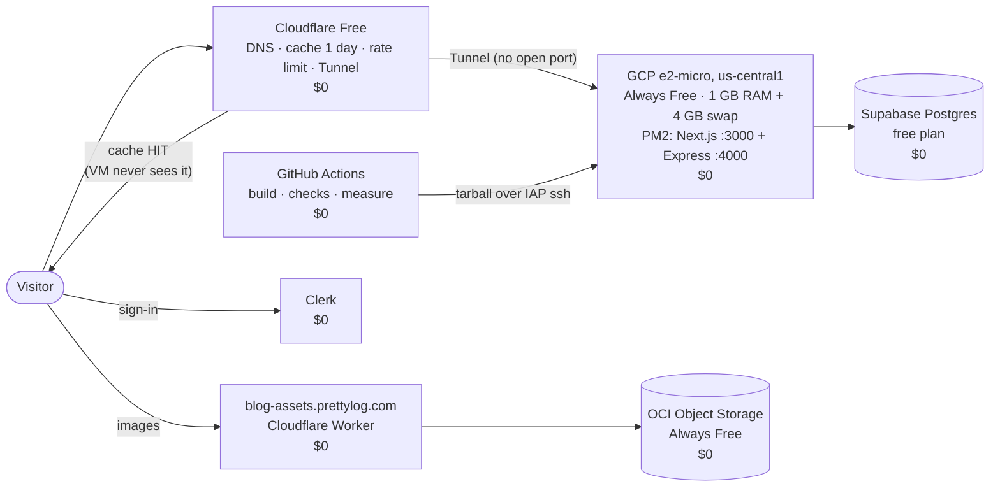
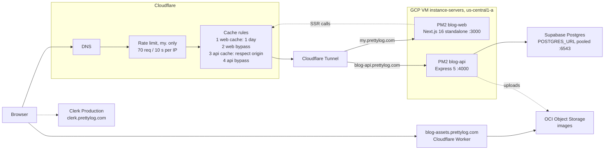
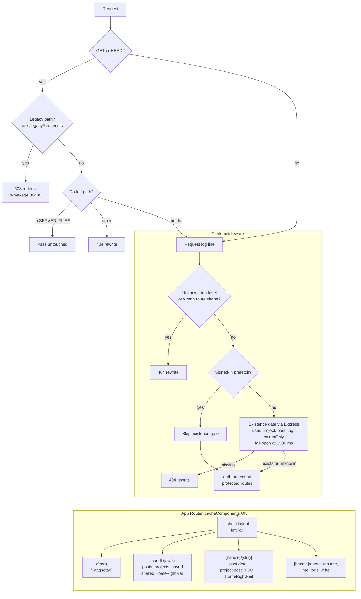
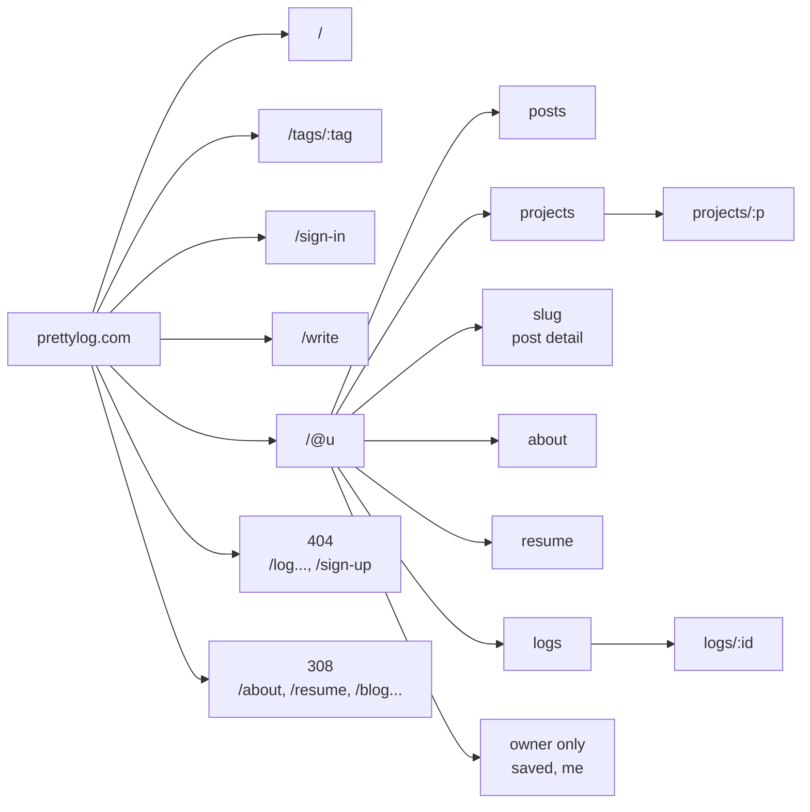
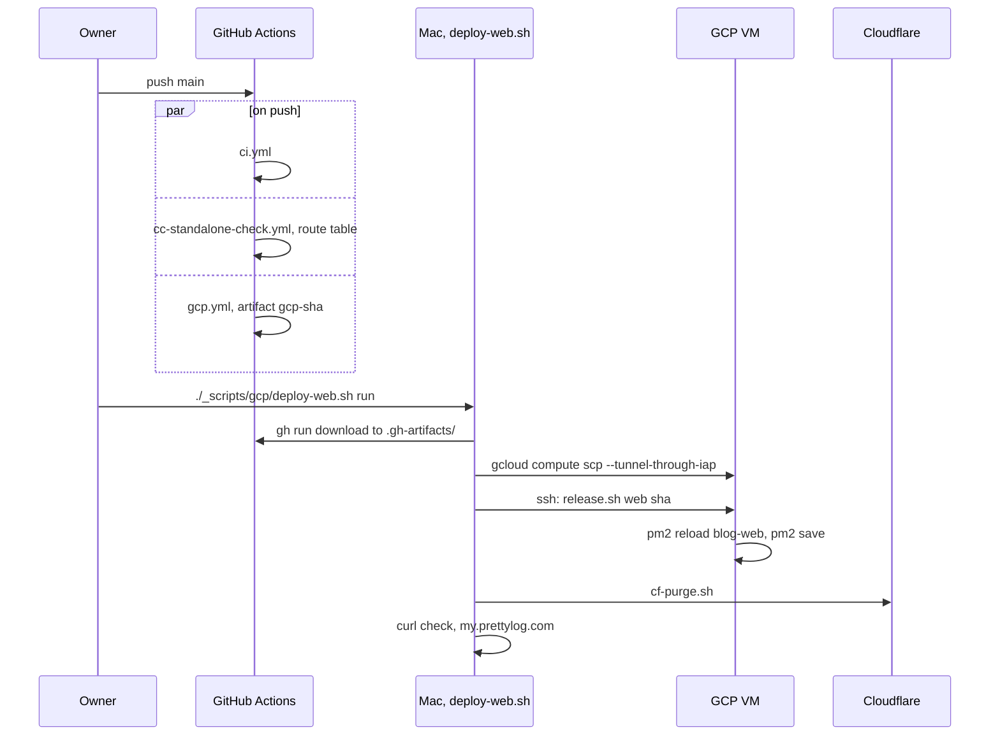
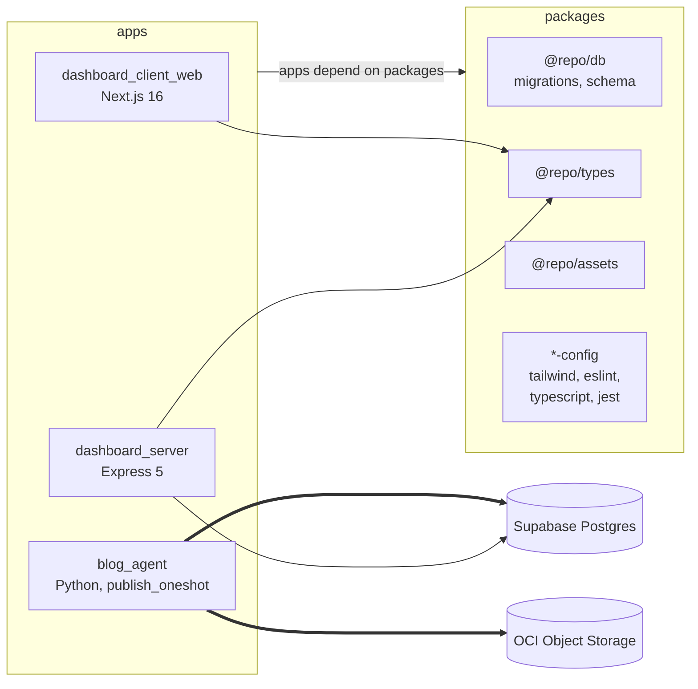

# tradelunch

Personal portfolio + blog for Taek Lim.

Live: [my.prettylog.com](https://my.prettylog.com)

| Hosting (2026-10-14) | |
| --- | --- |
| web + api | GCP VM `instance-servers`, PM2 (`blog-web` :3000, `blog-api` :4000) |
| edge | Cloudflare (Tunnel, cache rules, rate limit 70 / 10 s) |
| prod web | `3996711` |
| Vercel | retired ([`gcp.design.md`](./gcp.design.md)) |

The finance dashboard moved to the separate `project_tradelunch_finance` repo on 2026-07-09.
This repo is blog-only.

---

## A full-stack blog on free tiers: ≈ $3.65 / month

Next.js 16 SSR + Express API + Postgres + image CDN + auth, on one 1 GB free VM.

### Free tier specs (checked 2026-10-14)

| Service | Free tier | What this blog uses it for |
| --- | --- | --- |
| **GCP** Compute Engine | 1 × e2-micro / month (us-west1, us-central1, us-east1) · 30 GB standard disk · 1 GB egress / month · no external IPv4, no snapshots | VM: Next.js + Express (PM2) |
| **GCP** Cloud Logging | 50 GiB ingest / project / month · 30-day default retention | request + SSR fetch logs |
| **Cloudflare** Free | CDN + cache (HTML needs a Cache Rule) · no bandwidth cap · 10 Cache Rules · 1 rate-limit rule (per IP, 10 s) · Tunnel $0 · unmetered DDoS · Universal SSL | edge cache, rate limit 70 / 10 s, Tunnel to the VM |
| **Cloudflare** Workers | 100,000 requests / day · 10 ms CPU / request | `blog-assets.` image proxy |
| **OCI** Always Free | Object Storage 20 GB (Always-Free account; 10+10+10 GB on paid) · 50,000 API requests / month · 10 TB egress / month | post images |
| **Supabase** Free | 500 MB DB · 5 GB egress (+5 GB cached) · 1 GB files · 50,000 MAU · pauses after 7 days idle · 2 projects · pooler 200 / direct 60 connections | Postgres |
| **Clerk** Hobby | 50,000 monthly retained users / app · 7-day sessions · no MFA / SSO | sign-in |
| **GitHub Actions** | public repo free · private 2,000 min / month · 500 MB artifacts · 90-day retention | build, route check, browser measure |

Details and sources: [`research/free-tiers-2026-10.md`](./research/free-tiers-2026-10.md).



| Piece | Free tier used | Cost |
| --- | --- | --- |
| Compute | GCP e2-micro (1 VM, us-central1, 30 GB disk, 1 GB egress / month) | $0 |
| External IPv4 on the VM | not in the free tier: $0.005 / hour | ≈ $3.65 |
| Edge, cache, DDoS, TLS, Tunnel | Cloudflare Free | $0 |
| Database | Supabase free plan (pooled `POSTGRES_URL`) | $0 |
| Images | OCI Object Storage Always Free + Cloudflare Worker | $0 |
| Auth | Clerk | $0 |
| CI/CD | GitHub Actions | $0 |

### How a 1 GB VM survives

| Trick | Why |
| --- | --- |
| Cloudflare caches anonymous HTML 1 day | most requests never reach the VM; saves the 1 GB egress |
| Cloudflare Tunnel, firewall denies all inbound | no open ports; ssh only via IAP |
| Build on GitHub Actions, ship a tarball | `next build` never runs on the VM |
| 4 GB swap + heap caps (`--max-old-space-size` 160 / 256 MB) | Next + Express fit in 1 GB RAM |
| `images.unoptimized` + pre-resized webp | no image CPU on the VM |
| proxy real-404 gates before render | scanners and bad URLs cost one cheap check, not a render |
| rate limit 70 req / 10 s per IP | one client cannot drain the VM |
| `release.sh` keeps 3 releases | rollback in seconds |

Sources: [`gcp.design.md`](./gcp.design.md) §3 (design-time limits), [`deploy/gcp/README.md`](./deploy/gcp/README.md), [`deploy/traffic/README.md`](./deploy/traffic/README.md).

---

## What's inside

pnpm + Turborepo monorepo, Node 24.

```text
apps/
  dashboard_client_web/   Next.js 16 App Router — blog + Log UI (SSR + client)
  dashboard_server/       Express 5 + pg Pool (raw SQL) → Supabase Postgres — /v1/api/*
  blog_agent/             Python (uv) — markdown blog publisher, writes DB + storage directly
packages/
  @repo/db                Supabase migrations + seed + schema snapshot (schema source of truth)
  @repo/types             Shared API-boundary types
  @repo/assets            Static assets (images, fonts, icons)
  @repo/{tailwind,eslint,typescript,jest}-config
```

Per-app READMEs:

- [`apps/dashboard_client_web`](./apps/dashboard_client_web/README.md) — Next.js client + SSR
- [`apps/dashboard_server`](./apps/dashboard_server/README.md) — Express API
- [`apps/blog_agent`](./apps/blog_agent/README.md) — markdown publisher (Python)

Product surfaces:

- **Blog / portfolio** — multi-user technical posts (Clerk auth), Markdown + LaTeX, likes,
  comments, saved posts, category/tag filters, in-app authoring at `/write`.
- **Log** — Threads-style microfeed at `/@username/logs` (and `/@username/logs/<logId>`):
  recursive replies, todo marks (owner-only), likes, follows, following timeline. The old
  `/log` feed and `/log/…` addresses were removed and return 404 (#113).
- **User routes** — `/@username/{posts,projects,about,resume,saved,me,logs}`. A project post
  detail shares its parent's right rail: TOC plus `HomeRightRail` (#118).
- **Sign-up is closed** (#117): `/sign-up` returns 404, the sign-in page hides the "Sign up"
  link, and the Clerk dashboard is set to Restricted.

---

## Infrastructure & architecture

### Request path



| Name | Value |
| --- | --- |
| Web host | `my.prettylog.com` to `localhost:3000` |
| API host | `blog-api.prettylog.com` to `localhost:4000` |
| Assets host | `blog-assets.prettylog.com` |
| `POSTGRES_URL` | pooled `:6543`, runtime |
| `POSTGRES_URL_NON_POOLING` | direct `:5432`, migrations |
| `STORAGE_PROVIDER` | `oci` |
| Firewall | inbound `tcp:22` from IAP only |

### Next.js request pipeline



| Layer | File |
| --- | --- |
| Proxy | `apps/dashboard_client_web/proxy.ts` |
| Gate kinds, route shapes | `utils/notFoundGate.ts`, `utils/knownTopLevelSegments.ts` |
| Legacy 308 | `utils/legacyRedirect.ts` |
| Server `catch` | `unstable_rethrow(error)` first |

### URL map



| Kind | Paths |
| --- | --- |
| Public | `/`, `/tags/:tag`, `/@u/{posts,projects,projects/:p,:slug,about,resume,logs,logs/:id}` |
| Owner only | `/@u/saved`, `/@u/me` |
| Signed in | `/write`, `/settings`, `/admin`, `/onboarding` |
| Removed, 404 | `/log...`, `/sign-up` |
| Moved, 308 | `/about`, `/resume`, `/blog...` |

### Cache layers

| Layer | Scope | Setting | Reset |
| --- | --- | --- | --- |
| Cloudflare edge, web | HTML, 1 day | cache rule "web cache" | manual `_scripts/cloudflare/cf-purge.sh` |
| Cloudflare edge, API | GET | respect origin | same purge |
| Next router cache | browser, per click | `staleTimes.dynamic` 30 s | 30 s |
| React `cache()` | one request | fetchers in `apis/` | request end |
| TanStack React Query | one tab | `ReactQueryProvider` | tab close |
| `cacheComponents` | static shell + Suspense holes | ON | deploy + purge |
| `'use cache'` | not used | dropped in #111 | |

### Build & deploy



| Script | Job |
| --- | --- |
| `_scripts/gcp/deploy-web.sh` | download, copy, release, purge, check |
| `_scripts/gcp/deploy-api.sh` | `blog-api` deploy |
| `_scripts/gcp/vm-metrics.sh` | VM memory and egress |
| `_scripts/cloudflare/cf-purge.sh` | purge the Cloudflare cache |
| `_scripts/cloudflare/traffic-check.sh` | PASS/FAIL on cache rules |

### Monorepo map



### Other GitHub workflows

| File | Trigger | Job |
| --- | --- | --- |
| `ci.yml` | push and PR to main | web lint, web and server `check-types` |
| `gcp.yml` | push to main (api, web, types paths), manual | build api and web tarballs, artifact `gcp-<sha>` |
| `cc-standalone-check.yml` | push to main (web paths), manual | standalone build, 404/200 route table |
| `cc-browser-measure.yml` | manual | Playwright, headless chromium |
| `load-test.yml` | manual | k6 sets L1, L2, L2-api |
| `logging-review.yml` | Monday 14:17 UTC, manual | weekly issue, cache rules check |
| `supabase-keepalive.yml` | Monday and Thursday 09:00 UTC, manual | Supabase keepalive |

---

## Quick start

Requires Node 24 (`nvm use`) and pnpm 9 (`corepack enable`). Use pnpm only — never npm or yarn.

```sh
pnpm install
pnpm dev             # all apps in parallel
pnpm dev:web         # client app only — http://localhost:3000
LOG_REQUESTS=false pnpm dev:web   # same, without the per-request JSON log lines (#58)
pnpm dev:server      # Express API only
pnpm dev:agent       # blog_agent CLI
```

Other common scripts:

```sh
pnpm build           # production build (turbo run build)
pnpm lint            # lint across workspaces
pnpm check-types     # tsc --noEmit per workspace (+ mypy for blog_agent)
pnpm format          # prettier write
```

Env files live per app (`.env`, `.env.local`, `.env.production`, `.env.example`).

### Local web against the production API (HTTPS, live Clerk keys)

Serves the local web at `https://local.prettylog.com` on port 443.
One-time setup (hosts entry, CORS origin, mkcert certificate): [`apps/dashboard_client_web/LOCAL_PROD_API.md`](./apps/dashboard_client_web/LOCAL_PROD_API.md).
The certificate lives outside the repo, in `~/.config/prettylog/certs/`.

```sh
# from the repo root
read -s 'PK?pk_live: ' && echo && read -s 'SK?sk_live: ' && echo

NEXT_PUBLIC_CLERK_PUBLISHABLE_KEY=$PK CLERK_SECRET_KEY=$SK \
NEXT_PUBLIC_API_BASE=https://blog-api.prettylog.com \
pnpm --filter dashboard_client_web exec next dev --turbopack -p 443 -H 0.0.0.0 --experimental-https \
  --experimental-https-key "$HOME/.config/prettylog/certs/local-key.pem" \
  --experimental-https-cert "$HOME/.config/prettylog/certs/local.pem"
```

---

## Documentation

- [`CLAUDE.md`](./CLAUDE.md) — repo topology, commands, architecture
- [`00.plan.md`](./00.plan.md) — product intent + roadmap
- [`00.tasks.md`](./00.tasks.md) — atomic task list (Phase CC, PJ closed 2026-10-14)
- [`01.status.md`](./01.status.md) — running status log
- [`log.plan.md`](./log.plan.md) — Log phases (Y, Y-TD, Y M2)
- [`decisions.plan.md`](./decisions.plan.md) — resolved architecture decisions
- [`gcp.design.md`](./gcp.design.md) — Vercel → GCP hosting design (draft)
- [`cc.design.md`](./cc.design.md) / [`cc.report.md`](./cc.report.md) — Phase CC (cache and cost, closed 2026-10-14): route groups, perf measurement. `cacheComponents` is ON in production (U4, `181e6ed`). Unknown pages get a real 404 from the proxy gate (`proxy.ts`, `utils/notFoundGate.ts`, `apis/existence.proxy.ts`). The gate kinds are user, project, post, log (#115) and owner-only. Deploy artifacts download to `.gh-artifacts/`. The CI check `cc-standalone-check.yml` runs on every push to `main` that touches the web app. Server fetcher `catch` blocks call `unstable_rethrow` first (runtime prerender). Cloudflare limit is 70 / 10 s. Purge is manual, staleness up to 1 day. See the [web README](./apps/dashboard_client_web/README.md#cachecomponents-is-on-in-production-u4).
- [`.claude/`](./.claude/) — agent harness: engineering principles and rules

---

## Admin bootstrap

There is **no admin-grant UI** by design — users are lazy-provisioned with `is_admin = false`.
To promote the owner, run a **one-time** SQL statement in the Supabase SQL Editor _after_ that
account has signed up and completed onboarding (so the `users` row exists):

```sql
UPDATE users SET is_admin = true WHERE username = '<owner-username>';
```

Match by `username` or `clerk_user_id` — **never `email`** (lazy-provisioned users have a NULL
`email`, so an email match silently updates zero rows). This single-owner bootstrap is intentionally
manual; an env/config allowlist would be over-engineering for one admin.

---

## Tech stack

Next.js 16 · React 19 · TypeScript strict · Tailwind v4 · Radix UI · shadcn/ui · lucide-react ·
Jotai · TanStack Query v5 · next-intl · Clerk (auth) · Express 5 · pg Pool · Supabase Postgres ·
OCI Object Storage · Cloudflare · Python (uv, LangGraph) · GitHub Actions · pnpm 9 · Turborepo ·
hosting: GCP VM (PM2) + Cloudflare Tunnel
