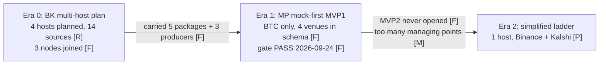
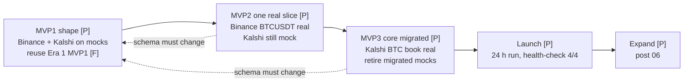

# Market Predict 프로젝트 연재(project series) 설계

> 상태: 설계 rev1 (system-architect, 2026-10-26). 글, 코드, 그림, SQL 실행 없음. 선택은 오너가 한다.
> 위치 근거: 선례 `prettylog-series.design.md`, `recobell-series.design.md`와 같은 루트 `*.design.md`다.
> `pg.plan.md`, `00.tasks.md`, `decisions.plan.md`는 product-manager(pm)와 main session이 고친다. 이 문서는 고치지 않는다.
> 원본 저장소 (읽기 전용, 아무것도 실행하지 않는다):
> `MP` = `~/Documents/project_market_predict/`, `BK` = `~/Documents/00_projects/project_betting_kalshi/`, `RA` = `~/Documents/00_projects/research_arbitrage_crypto/`.
> 이 문서 자체도 비밀 제거본이다. IP, 호스트 이름, 키, 계정 값은 한 개도 적지 않는다 (§8).
> 단순화 계획은 아직 없다. 오너 답 "아직 계획만" (2026-10-26). 그래서 §4는 전부 제안(proposed, P)이다.

## 0. 미션 블록 (인용)

> - Mission: 채용 담당자가 프로젝트 결과를 한눈에 보게 한다. (오너 승인 2026-10-13, #79)
> - Vision: 방문자가 `/@u/...` 한 체계에서 글, 프로젝트, 소개를 로그인 없이 읽는다. 옛 URL은 모두 새 URL로 연결된다. (오너 승인 2026-10-13, #79)

- 원본: `pg.plan.md` "Mission block" 13–14행. 이 연재용 `PLAN` 절은 아직 없다.
- 목표(goal) 초안 (오너 승인 전, pm이 plan에 옮긴다):
  - G-MP1: 연재 글 7개가 `projects/my-work/<slug>/` 아래 발행된다. 메뉴 Projects 배지(badge)는 발행 전 값 + 1이다 (§7.4).
  - G-MP2: 제안(P) 주장은 모두 "planned" 표시가 있다. 과거 시제로 쓴 P 주장은 0개다 (§8.4 R13).
  - G-MP3: 발행 전 원고와 운영 HTML에서 §8.3 grep 결과가 0건이다.
  - G-MP4: 모든 숫자에 저장된 출처 파일이 있다. 없는 값은 "not measured"로 적는다 (§9).
- 연재 자체의 전략 A/B/C는 없다. 그룹 모델(#119)과 발행 형식은 이미 정해졌다.
- §4.4의 A/B/C는 글이 소개할 **제안 시스템**의 선택지다. 연재의 전략이 아니다.

오너 요구 (verbatim, 2026-10-26):

> for my work, I would like to generate posts for my project: /Users/tio/Documents/project_market_predict
> want to provide plan and requirement and architecutures and mvp steps
> 1. I built first mvp but failed to launch: too many managing points - oracle, local, home server in korea, aws, too many data sources at first
> 2. decide to simplify and complete working version from mvp1 to mvp3 for btc-binance, kalshi-btc then will expand more
> 3. visualize as much as possible.

오너, 프로젝트 목적 (verbatim):

> event driven market prediction or searching for an arbirage gap

오너 답 (2026-10-26): 단순화 계획은 아직 만들지 않았다 ("아직 계획만"). 글만 쓴다. `MP`에는 쓰지 않는다.

## 1. 결과 요약

| 결정 | 권고 |
| --- | --- |
| 이야기 구조 | 세 시대(era). Era 0 = `BK` 다중 호스트 계획. Era 1 = `MP` mock MVP1 (gate 통과). Era 2 = 단순화 계획 (P) (§3) |
| 핵심 정정 | `MP` MVP1은 실패하지 않았다. gate PASS다 (`MP/STATUS.md` 39행). 열리지 않은 것은 MVP2다 (`MP/STATUS.md` 54행) |
| 글 수 | 7개: 개요 00 + 본편 01–06 (§5.2) |
| 프로젝트 slug | 기본 `market-predict` (§2.2) |
| 연재 제목 | 기본 "Market Predict". 형식 `Market Predict (n/6): <claim>` (§2.3) |
| 주장 표시 | F 코드·관측 기록, R 계획·README 문장, M 오너 기억, **P 제안 (만들지 않음)** (§3) |
| 핵심 그림 | 관리 지점(managing points) 전/후: mermaid 1장 + 표 1장 (F-MP03a, F-MP03b) |
| 그림 | 글 안 mermaid + Markdown 표 (#124). PNG 차트는 저장된 출력에서 1장만 (F-MP02d) |
| 제안 스택 | 기본 A: 호스트 1대, compose 하나에 Kafka + ClickHouse + Redis (§4.4) |
| 사다리 해석 | 기본: 사다리 하나. MVP1 둘 다 mock → MVP2 Binance 실 → MVP3 Kalshi 실 (§4.5, Q2) |
| 비밀 | IP, 노드 이름, Kalshi 키, DB 비밀번호가 원본에 있다. 값은 이 문서에 0개 (§8) |
| 열린 질문 | 16개, 모두 기본값 있음. 내용을 바꾸는 질문은 Q1(era), Q2(사다리), Q3(스택) (§11) |
| 막힘(blocker) | 없음. P 내용(§4)은 오너 승인 뒤 원고로 간다 (§12 D1) |

```text
BK, MP, RA (읽기만) ──► 사실 표 §3 (경로 + F/R/M) ──► 제안 §4 (전부 P) ──► 오너 승인 (D1)
                                                                              │
   00 개요 ─► 01 Era 0 관리 지점 ─► 02 Era 1 MVP1이 증명한 것 ─► 03 단순화 ─► 04 요구·구조 ─► 05 사다리 ─► 06 확장
비밀 제거 §8 ──► 원고 grep 0건 ──► reviewer 1회 ──► 오너 보안 확인 ──► 발행 ──► purge ──► 확인 §7.3
```

## 2. 목적, 제목, Projects 배치

### 2.1 목적

| 독자 | 1분 안에 보는 것 |
| --- | --- |
| 채용 담당자(recruiter) | 실패한 첫 시도를 숨기지 않는다. 무엇을 잘랐고 왜 잘랐는지 표로 본다 |
| 엔지니어(engineer) | 스키마 계약(schema contract), mock 우선 사다리(MVP ladder), 고의 파손(deliberate breakage) 검증 |

- 선례 형식: 그림 먼저, 키워드와 숫자, 긴 산문 없음 (MEMORY "Blog series: chart-first").
- 이 연재의 정직 규칙: 계획(P)을 결과처럼 쓰지 않는다. 결과 숫자는 Era 1의 기록뿐이다 (§9).

### 2.2 프로젝트 slug (URL segment)

| # | slug | 이유 | 판정 |
| --- | --- | --- | --- |
| **A** | **`market-predict`** | 원본 저장소 이름과 같다. "prediction"이라는 오너 목적의 앞 절과 맞다. 아직 차익 탐지(gap detection)를 만들지 않았으니 과장이 없다 | **기본** |
| B | `event-market-gap` | 오너 목적 "event driven … arbitrage gap"을 그대로 담는다. 그러나 gap 탐지는 06의 P뿐이다. URL이 계획을 결과처럼 보이게 한다 | 대안 |

- 그룹 사이에서도 title이 하나여야 한다 (#121, 루트 `CLAUDE.md` "Projects"). 사전 SELECT P3로 확인한다 (§7.1).
- 루트 `CLAUDE.md` 그룹 트리에 `my-work/` 아래 한 줄이 늘어난다 (§7.4).

### 2.3 연재 제목

| # | 제목 | 이유 | 판정 |
| --- | --- | --- | --- |
| **A** | **Market Predict** | 짧다. 접두가 3토큰(`Market Predict (n/6):`)이라 claim에 12토큰이 남는다. slug A와 같은 이름이다 | **기본** |
| B | Hunting the Arbitrage Gap | 목적이 바로 보인다. 그러나 gap을 찾는 코드가 없다. 01–05의 내용(수집, 단순화)과 맞지 않는다 | 대안. 06 제목에 "Arbitrage Gap"으로 살린다 |

- 00 형식: `Market Predict: <claim>` (접두 2토큰).
- 오너 목적 문장은 00 첫 줄 아래에 그대로 둔다: "Goal: event-driven market prediction, or finding an arbitrage gap."

### 2.4 Projects 배치

| 항목 | 값 |
| --- | --- |
| 그룹 | `my-work` (priority 10). 새 그룹 행 없음 |
| 카테고리 경로 | `projects` → `my-work` → `market-predict` |
| 발행 폴더 | `apps/blog_agent/posts/projects/my-work/market-predict/NN-<slug>/NN-<slug>.md` (`ps.plan.md` 9행의 `P` 형식) |
| 카드 | `my-work` 구역 카드 +1 (prettylog 옆) |
| 메뉴 배지 | 발행 시점 배지 + 1. 지금 계획 값 4 → 5, adriel 뒤 6 (§7.4) |
| 스키마, 코드 | 변경 0. 발행(INSERT)뿐. 그래서 이 연재에 MVP 사다리는 적용하지 않는다 |

## 3. 사실 지도와 주장 표시 (F / R / M / P)

### 3.1 표시 규칙

| 표시 | 뜻 | 글에 쓰는 법 |
| --- | --- | --- |
| **F** | 코드, 설정, 또는 관측 결과를 적은 문서 줄 (상태표, 실행 기록). 경로:행 | 사실 문장. Sources 표에 경로 |
| **R** | 계획, README, 설계 문서의 문장. 돌았는지는 말하지 않는다 | "planned", "the plan said" |
| **M** | 오너 기억 (2026-10-26 요구문) | "(owner)" 표시 |
| **P** | 이 문서의 제안. 만들지 않았다 | "Planned, not built" 상태 줄 + 미래 시제. 과거 시제 금지 |

- 한 상자, 한 행에 표시는 하나다. 섞이면 약한 쪽을 쓴다 (P < M < R < F).
- 그림 상자 이름 끝에 `[F]`, `[R]`, `[M]`, `[P]`를 붙인다. 글에도 남긴다 (recobell §3.2 선례).

### 3.2 세 시대 (era)



- 오너가 말한 "first mvp"가 어느 시대인지는 Q1이다. 기본: Era 0 + Era 1을 함께 "첫 시도"로 본다.
- 글에 쓰지 않는 문장: "MVP1 failed". 쓰는 문장: "MVP1 passed its gate. The real launch never happened."

### 3.3 Era 0: `BK` (다중 호스트 계획)

| # | 주장 | 표시 | 출처 |
| --- | --- | --- | --- |
| C1 | 데이터 소스 계획 14개: 중앙 거래소(centralized exchange, CEX) 4, 탈중앙 거래소(decentralized exchange, DEX) 3, Kalshi 1, 날씨 6 | R | `BK/_docs/collect.PLAN.md` 11–15행 |
| C2 | 계획 목적: 크립토와 예측시장 상관, 교차 거래소 차익(arbitrage) 탐지, 날씨 연구, ML 학습 데이터 | R | `BK/_docs/collect.PLAN.md` 17–22행 |
| C3 | 배치 계획: Mac Mini K3s 클러스터(Kafka, TimescaleDB, Grafana, ingress) + AWS, GCP, Oracle 무료 등급 agent. VPN 겹망(overlay)으로 연결 | R | `BK/_docs/collect.PLAN.md` 26–43, 429–461행 |
| C4 | agent 배치표: crypto는 AWS, weather는 GCP, kalshi는 Oracle, db-consumer는 Mac Mini | R | `BK/_docs/collect.PLAN.md` 456–461행 |
| C5 | 2026-04-08 확인된 K3s 노드 3대: Oracle 4-CPU (제어부, control plane), Oracle 1-CPU, Mac Mini | F | `BK/_doc_history/29.infrastructure_state.md` 15, 18–23행 (노드 이름은 쓰지 않는다) |
| C6 | 같은 표: Kafka는 Oracle 4-CPU에서 systemd로 돈다. Redis는 Helm. producer는 배포 전. 모니터링은 계획 단계 | F | `BK/_doc_history/29.infrastructure_state.md` 7–16, 44–48행 |
| C7 | Oracle 1-CPU는 쓰지 않는 상태 | F | `BK/_doc_history/29.infrastructure_state.md` 65–67행 |
| C8 | ClickHouse + Grafana는 Mac Mini의 docker compose. 3 GB 컨테이너 설정 | R | `BK/README.md` 55, 86행 |
| C9 | 앱: producer 6개 (Kalshi WS, Kalshi REST, Kalshi hist, weather, Binance, Coinbase) + Python `ml_server` (공정가, Kelly 배팅 크기, 집행) + api + web | R | `BK/README.md` 3, 40–47행 |
| C10 | Kafka 토픽 40개 = kalshi 29 + crypto 4 + weather 7 | R | `MP/00.architecture.mvp1.md` 1329행 |
| C11 | 홈 서버(Mac Mini)의 위치는 한국 | M | 오너 2026-10-26. 파일 없음 |
| C12 | 첫 시도가 오르지 못한 이유: 관리 지점이 너무 많았다. 데이터 소스도 처음부터 너무 많았다 | M | 오너 2026-10-26 |
| C13 | 2026-04-08 뒤에 producer가 배포됐는지는 이 문서가 확인하지 않았다 | 없음 | Q9. 글은 "as of the 2026-04-08 state table"로만 쓴다 |

- AWS, GCP는 계획 표(C3, C4)에만 있다. 노드 표(C5)에는 없다. 그래서 그림에서 "planned" 점선으로 그린다.
- GCP는 오너 목록에 없다. 파일에는 있다. 넣을지는 Q7 (기본: 점선 planned로 넣는다).

### 3.4 Era 1: `MP` (mock 우선 MVP1)

| # | 주장 | 표시 | 출처 |
| --- | --- | --- | --- |
| C20 | 범위: BTC만. MVP1은 mock API + mock 데이터, Kafka 연결 0개 | F | `MP/PLAN.md` 15–16, 22행 |
| C21 | `BK`에서 골라 옮김: 패키지 5개 + producer 3개. 버림: weather, `ml_server`, `k8s/`, 차익·Kelly·집행, Rust, Vagrant | F | `MP/PLAN.md` 21행 |
| C22 | Kafka는 원격 Oracle. Redis + ClickHouse는 로컬 colima | F | `MP/PLAN.md` 24행 |
| C23 | 계약의 venue 4개: kalshi, polymarket, binance, coinbase. Polymarket 코드는 0줄 (스키마만) | F | `MP/PLAN.md` 26행, `MP/00.architecture.mvp1.md` 18–21행 |
| C24 | 데이터 표 6개: `pred_market_tick_ws`, `pred_trade_ws`, `pred_orderbook_ws`, `pred_orderbook_delta_ws`, `crypto_ticks`, `crypto_trades` | F | `MP/packages/db/migrations/clickhouse/001_data_tables.sql` 25, 46, 64, 80, 96, 114행 |
| C25 | proto 메시지 5개: `PredMarketTick`, `PredTrade`, `PredOrderbook`, `CryptoTrade`, `CryptoTick` | F | `MP/packages/schema/src/proto/pred.proto` 22, 41, 57행, `crypto.proto` 16, 31행 |
| C26 | mock 파일 6개, 표와 1:1. 모든 mock 심볼은 `MOCK_`로 시작 | F | `MP/00.architecture.mvp1.md` 72–77행, `MP/PLAN.md` 95행 |
| C27 | 흐름: mock → writer → Redis(현재 상태) / ClickHouse(이력) → api(Hono, 서버 전송 이벤트(server-sent events, SSE): 서버가 여는 단방향 흐름) → web(Vite + React) | F | `MP/00.architecture.mvp1.md` 22–26, 59–64행 |
| C28 | 단계표: MVP2 = Binance BTC 실 조각, MVP3 = Kalshi 오더북 경로 | F | `MP/PLAN.md` 35–39행, `MP/00.architecture.mvp1.md` 1283–1294행 |
| C29 | MVP1 gate PASS 2026-09-24. 독립 reviewer가 시연을 직접 재현 | F | `MP/STATUS.md` 35, 39행, `MP/PLAN.md` 151행 |
| C30 | 시연 값: writer stdout 2,519줄, `jq` 실패 0. 12초 동안 두 venue 전진. writer를 끄자 양쪽 STALE 41,611 ms | F | `MP/STATUS.md` 35행 |
| C31 | 첫 장시간 실행 3h18m, writer 로그 54,107줄. kalshi `stale_ms` 첫 500개 평균 1321.51, 마지막 500개 평균 1322.02. rejected, error 0. health-check 4/4 | F | `MP/STATUS.md` 52행 |
| C32 | health-check의 `jq` 단계: 23,601줄에 63초 → 0.14초 | F | `MP/STATUS.md` 49행 |
| C33 | MVP2는 오너 지시로 닫힌 채다 | F | `MP/STATUS.md` 54행 |
| C34 | MVP2, MVP3 선행 과제가 열려 있다: M1–M4, U11–U14. U12는 실 Kalshi 메시지 캡처, U14는 Oracle 브로커에 토픽 4개 생성 | F | `MP/PLAN.md` 188–208행 |
| C35 | Kafka를 고른 이유 (오너): 수집 중 유실 방지(durability) + 처리량 여유 | R | `MP/STATUS.md` 46행 |
| C36 | 저장된 로그: `logs/writer.jsonl` 243줄, 2026-10-04 짧은 실행 (약 47초) | F | `MP/logs/writer.jsonl`, `MP/logs/api.jsonl` 1–3행 |
| C37 | 3h18m 실행의 원시 로그는 지금 `logs/`에 없다 | F | C36과 비교. §9 |

- 02 글의 숫자는 C30–C32뿐이다. 모두 "logged result" 표시를 단다. 원시 로그가 없기 때문이다 (C37).
- 책 `MP/book_market_predict_trading/`(한국어, 4장 완료)은 출처로만 쓴다. 링크하지 않는다 (Q13).

### 3.5 확장 근거 (`RA`)

| # | 주장 | 표시 | 출처 |
| --- | --- | --- | --- |
| C40 | 예측시장 차익의 세 종류: 교차 플랫폼(cross-platform, Kalshi 대 Polymarket), 교차 자산(cross-asset, 옵션 내재 확률 대 Kalshi), 지연 차익(latency arbitrage, 현물 움직임 뒤 예측시장 갱신 지연) | R | `RA/00_betting_arbitrage/plan.md` 9–23행 |
| C41 | 그 문서 표의 예시 확률 숫자 | 쓰지 않는다 | 예시값이다. 측정이 아니다 |

- 왜 Binance + Kalshi 짝인가: 지연 차익(C40 셋째)은 현물 1곳 + 예측시장 1곳만 있으면 볼 수 있다. 이 연결은 architect의 제안이다 (P). 오너 확인은 Q12.

## 4. 단순화 설계 초안 (전부 P)

> 이 절의 모든 줄은 P다. 오너가 승인하기 전에는 원고로 가지 않는다 (§12 D1).
> `MP`의 잠긴 결정(`MP/PLAN.md` 18–31행)과 다른 줄이 있다. 예: Kafka 위치. 그 변경은 `MP`의 결정이다. 이 문서는 글에 "planned"로만 싣는다.

### 4.1 풀려는 문제와 목표

| 칸 | 내용 |
| --- | --- |
| 풀려던 문제 | 관리 지점이 너무 많아 실 데이터 한 줄도 오르지 못했다 (C12 M, C33 F) |
| 임무(mission) | 사건 기반 시장 예측(event-driven market prediction) 또는 차익 틈(arbitrage gap) 찾기 (오너) |
| 비전(vision) | 한 호스트에서 BTC 현물과 Kalshi BTC 계약이 같은 계약(schema) 위에 쌓이고, 화면 한 장에 보인다 [P] |
| 이번 범위 목표 | 실 조각 하나를 호스트 하나에서 끝까지 돌린다. 그다음 Kalshi [P] |

### 4.2 관리 지점 예산 (managing-point budget)

| 항목 | Era 0 계획 [R] | Era 0 확인 [F] | Era 1 [F] | Era 2 제안 [P] |
| --- | --- | --- | --- | --- |
| 계산 호스트 | 4 (Mac Mini, AWS, GCP, Oracle) | 3 노드 (Oracle 2, Mac Mini 1) | 2: 노트북 (사용) + Oracle 브로커 (설계상, MVP2부터) | **1** |
| 클라우드 업체 | 3 | 1 (Oracle) | 1 (Oracle) | **0** (A안) 또는 1 (B안) |
| 사설망 겹망(overlay) | 1 | 기록 없음 | 0 | **0** |
| 오케스트레이션(orchestration) | K3s | K3s | colima compose | **compose 하나** |
| 데이터 소스 / venue | 14 | 기록 없음 | 4 (스키마), 0 (실기동) | **2** (Binance, Kalshi) |
| 심볼 | BTC, ETH, SOL, XRP + 날씨 | 기록 없음 | BTC | **BTC 1쌍** |
| Kafka 토픽 | 계획 표에 수 없음 | 40 (C10, R) | 0 소비 | **4–6**: crypto 2 (MVP2) + `pred.*` 2–4 (MVP3 설계 때 정함) |
| 실기동 producer | 3 계획 | 0 (2026-04-08) | 0 | **2** |

- 출처: C1–C10, C20–C34. Era 2 칸은 이 문서의 제안이다.
- 글 03의 F-MP03b가 이 표를 그대로 쓴다. "기록 없음" 칸은 빈 칸으로 두지 않는다.

### 4.3 요구 사항 (requirements)

| # | 종류 | 요구 | 근거 |
| --- | --- | --- | --- |
| FR1 | 기능 | Binance BTCUSDT 시세(tick)와 체결(trade)을 공개 WS로 받는다. 키 없음 | C21 producer 이식분, C28 |
| FR2 | 기능 | Kalshi BTC 시리즈 시세와 오더북을 WS로 받는다. 키 필요 | C28, C34 |
| FR3 | 기능 | 이력은 ClickHouse 표 6개 중 쓰는 것에 쌓는다. 표 정의는 바꾸지 않는다 | C24 |
| FR4 | 기능 | 현재 상태는 Redis. api가 스냅샷 1개와 서버 전송 이벤트(server-sent events, SSE) 흐름을 준다 | C27 |
| FR5 | 기능 | 화면 1장: BTC 가격선 + Kalshi 오더북 + 신선도(freshness) + mock/live 배지 | C27 |
| FR6 | 기능 | mock 행과 실 행이 같은 표에 공존한다. `MOCK_` 접두로만 구분한다 | C26, C28 |
| NFR1 | 운영 | 호스트 1대. 클라우드 0 또는 1 | §4.2 |
| NFR2 | 운영 | venue는 2개를 넘지 않는다. 3번째는 MVP3 exit 뒤 (06) | C12 |
| NFR3 | 운영 | 로그는 JSON 한 줄, `logs/*.jsonl`. 모니터링 스택 없음 | `MP/PLAN.md` 23행 |
| NFR4 | 운영 | health-check 불변식 4개가 언제나 다시 돈다 | C32, `MP/PLAN.md` 177행 |
| NFR5 | 보안 | 키와 비밀번호는 `.env`에만. 저장소와 글에 0개 | §8 |
| NFR6 | 계약 | MVP2, MVP3에서 proto와 `001_data_tables.sql` 변경 0줄. 바꿔야 하면 MVP1로 돌아간다 | `.claude/CLAUDE.md` "System build phasing" Invariants |

### 4.4 제안 스택 A / B / C

각 안이 목표 "실 조각 하나를 호스트 하나에서 끝까지"(§4.1)를 어떻게 따르는지 적는다.

| 안 | 모양 | 얻는 것 | 잃는 것 | 목표 추적 | 판정 |
| --- | --- | --- | --- | --- | --- |
| **A 안정(stable)** | 호스트 1대(노트북). compose 하나에 Kafka 브로커 1개 + ClickHouse + Redis | 원격 0. Kafka 엔진 표(MVP2 `002_kafka_engines.sql`)와 전달 의미(delivery)가 그대로 | 24시간 가동은 노트북 상태에 묶인다 | 호스트 1, 계약 변경 0 | **기본** |
| B 확장(scalable) | 같은 compose를 클라우드 VM 1대에서 24시간. 노트북은 mock 개발만 | 상시 수집 | 클라우드 업체 1, 원격 배포 1 = 관리 지점 +2 | 호스트 1, 클라우드 1 | MVP3 exit의 24시간 run이 노트북으로 안 될 때만 |
| C 최신(cutting-edge) | 브로커 없음. producer가 ClickHouse에 직접 넣고 Redis에 쓴다 | 부품 최소 | Kafka를 고른 이유(C35, 유실 방지)를 버린다. 전달 의미 설계(`MP` §5)를 다시 써야 한다 | 계약 표는 같지만 흐름이 바뀐다 | 버림. 06에 "rejected" 1행 |

- 글 04는 세 안을 표 하나로 보이고 A를 "planned choice"로 쓴다. 오너가 다른 안을 고르면 04, 05만 바뀐다.
- Kafka를 원격 Oracle에서 로컬로 옮기는 것은 `MP`의 잠긴 결정 변경이다 (`MP/PLAN.md` 24행). Q3에서 오너가 정한다.

### 4.5 MVP 사다리 (기본 해석: 사다리 하나)

사다리 정의는 `.claude/CLAUDE.md` "System build phasing"이 갖는다. 여기서는 칸만 채운다.



| 단계 | 끝에서 끝 순환(end-to-end cycle) | exit 기준 (제안) | 기존 근거 |
| --- | --- | --- | --- |
| MVP1 | Binance tick mock + Kalshi 오더북 mock → writer → Redis/ClickHouse → api → web | 화면에 BTC mock 가격선과 Kalshi mock 오더북이 함께 갱신된다. writer를 끄면 stale. Kafka 연결 0 | Era 1 MVP1 재사용 (같은 종류, mock). 차이: 화면의 두 번째 패널이 Polymarket → Binance |
| MVP2 | Binance producer 실기동 → 로컬 Kafka → `crypto_ticks`, `crypto_trades` → api → web. Kalshi는 mock | `venue='binance'` 심볼이 정확히 `MOCK_BTCUSDT`, `BTCUSDT` 2개. proto와 `001` diff 0줄. producer 재시작 뒤 `FINAL` 중복 0 | `MP/PLAN.md` 38행 exit, M1–M4 |
| MVP3 | Kalshi producer 실기동 → `pred.*` 토픽 → writer `kafkaSource` → Redis `ob:kalshi:*` 실 티커 | `pred_orderbook_ws` `FINAL` 행 수 = 고유 idempotency key 수. 옮긴 경로의 mock만 `x_`. 선행: U12 캡처, U13 seq 판정, U14 토픽 | `MP/PLAN.md` 39행 exit, 193–208행 |
| Launch | MVP3 상태로 24시간 | health-check 4/4, `jq` 실패 0, rejected 0 | C31의 3h18m 형식을 24시간으로 |

- 대안 해석 (Q2): 사다리 둘. btc-binance MVP1→3을 끝낸 뒤 kalshi-btc MVP1→3. 그러면 05의 그림이 두 줄이 된다.
- 기본을 고른 이유: 오너 문장의 순서(btc-binance, kalshi-btc)와 같다. `MP` 단계표(C28)와 같다. MVP2 = "1–2 simple tasks" 규칙과 맞다.

### 4.6 구성 요소와 계약 (제안)

| # | 구성 요소 | 하는 일 | 상태 |
| --- | --- | --- | --- |
| K1 | `prod-crypto-binance-ts` | BTCUSDT tick, trade → Kafka `crypto.ticks`, `crypto.trades` | 코드 있음 [F], 실기동 없음. MVP2에서 [P] |
| K2 | `prod-kalshi-ws-ts` | Kalshi BTC 시리즈 tick, 오더북 → `pred.*` | 코드 있음 [F], 실기동 없음. MVP3에서 [P] |
| K3 | Kafka 1 브로커 (로컬) | 유실 방지 버퍼 | [P] (A안). Era 1은 원격 Oracle [F] |
| K4 | ClickHouse Kafka 엔진 표 + 물질화 뷰(materialized view, MV): 들어온 행을 표로 옮기는 뷰 | 토픽 → 이력 표 | `002`는 아직 없음 [F]. [P] |
| K5 | `orderbook-writer` | 스냅샷 → Redis, 마지막 쓰기 우선(last write wins, LWW) 가드: 더 오래된 시각은 거부 | 있음 [F], mockSource만 |
| K6 | `apps/api` (Hono) | `/api/orderbook/:venue/:ticker`, 서버 전송 이벤트(server-sent events, SSE) | 있음 [F] |
| K7 | `apps/web` | 화면 1장 | 있음 [F]. Binance 패널은 [P] |
| K8 | `health-check.sh` | 불변식 4개 | 있음 [F] |

mock API 계약 (MVP1이 도는 대상, 제안):

| 경로 | 응답 형태 | 상태 |
| --- | --- | --- |
| `GET /api/orderbook/:venue/:ticker` | `OrderbookSnapshot`: venue, ticker, bids, asks (`{price, qty}` 문자열), `time_ms`, `stale_ms`, `feed` | 있음 [F] (`MP/PLAN.md` 124–127행) |
| 서버 전송 이벤트(server-sent events, SSE) 흐름 | 바뀐 스냅샷만 보낸다 | 있음 [F] (`MP/PLAN.md` 131행) |
| `GET /api/ticks/binance/:symbol` (이름 제안) | 최근 N개 tick, 같은 `feed` 규칙 | **[P] 새 경로.** 계약은 `packages/schema/src/view/`에 먼저 쓴다 |

- 지금 api는 Redis만 읽는다. ClickHouse는 일부러 연결하지 않았다 (`MP/STATUS.md` 26행, `MP/PLAN.md` 128행).
- 그래서 tick 경로는 api의 **첫 ClickHouse 읽기 경로**이거나 Redis tick 캐시가 새로 필요하다 [P]. 어느 쪽인지는 MVP1 설계 일이다.
- 05의 "단계 × 구간" 표는 api를 "바뀜 [P]"으로 표시한다. "MVP1 = Era 1 재사용"은 api, web 두 곳의 변경을 빼고만 맞다.

- 새 경로 하나는 MVP1 일이다. view 계약을 먼저 쓰고 mock으로 돌린다. MVP2에서 바꾸면 사다리 위반이다.
- 저장 설계: 표 6개 그대로 (C24). 새 표 0개. Redis 키 규칙 그대로 (`ob:<venue>:<ticker>`).

## 5. 연재 계획

### 5.1 제목과 길이 규칙

- 형식: `Market Predict (n/6): <claim>`. 00 = `Market Predict: <claim>`. 15토큰 이하 (공백 토큰).
- 접두 토큰: 번호 글 3개, 00 2개.
- P 글(03–06) 제목 끝에 "(Planned)"를 붙이거나 claim에 "Plan"을 넣는다.
- 길이: prettylog, recobell 기준 본문 50–75줄. 산문은 그림 하나에 1–2줄.
- P 글의 첫 줄 (썸네일 다음): `> Status: planned, not built (as of 2026-10-26).`

### 5.2 글 목록

| # | 폴더 | 제목 (작업용, 영어) | 토큰 | 한 줄 목적 | 핵심 그림·표 | 표시 | 길이 |
| --- | --- | --- | --- | --- | --- | --- | --- |
| 00 | `00-overview` | Market Predict: Event-Driven Prediction, Rebuilding One Slice at a Time | 10 | 목적, 세 시대, 연재 지도를 1분에 본다 | F-MP00a, F-MP00b, F-MP00c | F + M + P | 60줄 |
| 01 | `01-too-many-managing-points` | Market Predict (1/6): Four Planned Hosts, Fourteen Sources, Forty Topics, No Launch | 12 | Era 0가 무엇을 관리해야 했나 | F-MP01a, F-MP01b, F-MP01c | R + F + M | 65줄 |
| 02 | `02-what-mvp1-proved` | Market Predict (2/6): A Mock-First Pipeline Ran 3h18m With Flat Drift | 11 | Era 1 MVP1이 증명한 것과 남은 원격 의존 | F-MP02a, F-MP02b, F-MP02c, F-MP02d | F | 70줄 |
| 03 | `03-simplify-the-scope` | Market Predict (3/6): The Plan Is One Host, Two Venues, One BTC Pair | 12 | 무엇을 자르고 왜 자르나 | F-MP03a (핵심), F-MP03b, F-MP03c | P (전/후의 "전"은 F/R) | 60줄 |
| 04 | `04-requirements-and-architecture` | Market Predict (4/6): Planned Requirements and Architecture for Binance and Kalshi BTC | 12 | 요구, 구성 요소, 흐름, 계약, 스택 선택 | F-MP04a, F-MP04b, F-MP04c, F-MP04d, F-MP04e | P | 75줄 |
| 05 | `05-mvp-ladder` | Market Predict (5/6): The Planned Ladder: Mocks First, Binance Real, Then Kalshi | 12 | MVP1 → MVP3 → 가동, exit 기준, 되돌림 규칙 | F-MP05a, F-MP05b, F-MP05c | P | 65줄 |
| 06 | `06-expansion-and-the-gap` | Market Predict (6/6): After the Ladder, More Venues and the Arbitrage Gap (Planned) | 13 | 확장 순서와 gap 신호의 모양 | F-MP06a, F-MP06b, F-MP06c | P + R | 50줄 |

- 01 제목 "Four Planned Hosts"는 C3(R) 계획 값이다. "Forty Topics"는 C10(R)이다. "No Launch"는 C12(M) + C33(F)이다. 본문 첫 줄에서 셋의 표시를 밝힌다.
- 02 제목 "3h18m", "Flat Drift"는 C31(F)이다. "logged result, raw log not kept" 이름표를 본문 첫 표에 단다.

### 5.3 글마다 절 (영어, 작가는 이 순서로 쓴다)

| 글 | 절 |
| --- | --- |
| 00 | Result · Goal (owner's words) · Three eras · Before and after · Series map · Sources |
| 01 | Result · What the plan wanted (14 sources) · Hosts planned vs hosts joined · Managing points table · Why it never launched (owner) · What we never measured · Sources |
| 02 | Result · What carried over and what was dropped · The contract: 6 tables, 5 messages, 6 mock files · Mock-first flow · Gate demo numbers · The 3h18m run · What still needed a remote broker · Sources |
| 03 | Status line · Result · The cut list · Managing points before and after · What stays (the contract) · What may come back later · Sources |
| 04 | Status line · Result · Requirements · Components · Data flow · Mock API contract · Storage · Stack options A/B/C · Sources |
| 05 | Status line · Result · The ladder · Stage by phase (mock or real) · Exit criteria · When a slice goes back to MVP1 · Launch check · Sources |
| 06 | Status line · Result · Expansion order · Three kinds of arbitrage gap · The gap signal, as a plan · Kill conditions · Sources |

- 01 "Why it never launched": 오너 문장 C12를 인용하고 [M]을 단다. 원인을 더 지어내지 않는다.
- 02 "What still needed a remote broker": MVP2 exit에 원격 Oracle Kafka가 들어 있었다 (C22, C34). 이것이 03의 다리다.
- 06 확장 순서 (제안): Coinbase (현물 둘째, 교차 거래소) → Polymarket (venue↔instrument 대응 계층 필요, `MP/00.architecture.mvp1.md` 1306–1312행) → 사건 기반 예측. 각 단계는 다시 사다리를 탄다.

### 5.4 숫자 규칙

| 숫자 | 출처 | 글에 쓰는 법 |
| --- | --- | --- |
| 14 sources, 4 planned hosts, 3 clouds | C1, C3 (R) | "planned" 이름표 |
| 3 nodes joined | C5 (F) | "as of the 2026-04-08 state table" |
| 40 topics | C10 (R) | "recorded in the design doc" |
| 6 tables, 5 messages, 6 mock files | C24–C26 (F) | 그대로 |
| 2,519 lines, 0 jq failures, STALE 41,611 ms | C30 (F) | "gate demo, logged result" |
| 3h18m, 54,107 lines, 1321.51 → 1322.02 ms | C31 (F) | "logged result, raw log not kept" |
| 63 s → 0.14 s | C32 (F) | "health-check jq step, logged result" |
| 1 host, 2 venues, 4 topics, 24 h | §4 (P) | "planned target". 제목에 쓰면 "Plan" 또는 "(Planned)"를 같이 쓴다 |
| 비용, 데이터 양, 지연, 수익, gap 크기 | 없음 | 쓰지 않는다. "not measured" (§9) |

## 6. 그림

### 6.1 만드는 법

- 다이어그램: 글 안 ` ```mermaid ` 블록. 블로그가 client에서 그린다 (#124, recobell §6.4).
- 표: Markdown 표. 칸마다 한 항목 (`rules/writing/style.md` §2).
- 데이터 차트 PNG: 저장된 출력에서만. 이 연재에는 1장 (F-MP02d).
- PNG 실행: `OMP_NUM_THREADS=1 timeout 300 uv run python ...` (`~/.claude/CLAUDE.md` "Allowed locally"). 입력은 `MP/logs/writer.jsonl` 사본 또는 손으로 모은 CSV뿐이다.
- P 그림의 상자는 모두 `[P]`. 숫자가 있으면 캡션에 "Illustrative values" 또는 "planned target".
- mermaid 한 장에 상자 12개 이하 (recobell §10 위험 행).
- 캡션: 두 문장 이하. 둘째 문장은 "Why:" (`rules/figures.md` §3).

### 6.2 그림 목록

| F | 글 | 형식 | 보이는 것 | 데이터 출처 |
| --- | --- | --- | --- | --- |
| F-MP00a | 00 | mermaid flowchart | 세 시대 흐름 (§3.2 그림) | C1–C37, §4 |
| F-MP00b | 00 | Markdown 표 | 관리 지점 전/후 요약 4행 (호스트, 클라우드, 소스, 토픽) | §4.2 |
| F-MP00c | 00 | Markdown 표 | 연재 지도: 글, 질문, 표시 | §5.2 |
| F-MP01a | 01 | mermaid flowchart | Era 0 배치: 확인 노드 실선 [F], 계획 agent 점선 [R], 위치 [M] | C3–C8, C11 |
| F-MP01b | 01 | Markdown 표 | 관리 지점 표: 호스트, 클라우드, 겹망, 오케스트레이션, 저장소, 브로커, producer, 토픽 | C3–C10 |
| F-MP01c | 01 | mermaid mindmap 또는 표 | 데이터 소스 14개 묶음 (CEX 4, DEX 3, Kalshi 1, 날씨 6) | C1 |
| F-MP02a | 02 | mermaid flowchart | mock → writer → Redis/ClickHouse → api → web. Kafka 상자 점선 "0 connections" | C20, C27 |
| F-MP02b | 02 | Markdown 표 | 계약: 표 6 ↔ mock 6 ↔ 메시지 5 | C24–C26 |
| F-MP02c | 02 | Markdown 표 | 기록된 결과: 시연(C30), 3h18m(C31), health-check(C32). 칸 = 값, 경로, "logged" | C30–C32 |
| F-MP02d | 02 | PNG 차트 `fig_02_snapshots.png` | 2026-10-04 짧은 mock run: 초당 적용 스냅샷 수, venue별 선 2개 | `MP/logs/writer.jsonl` (243줄, `message="snapshot applied"`). 캡션: "47-second local mock run" |
| F-MP03a | 03 | mermaid flowchart (부분 그래프 2개) | **핵심 그림.** 왼쪽 Era 0: 호스트 4, 클라우드 3, 겹망, K3s, 소스 14. 오른쪽 Era 2: 호스트 1, compose 1, 소스 2 [P] | §4.2 |
| F-MP03b | 03 | Markdown 표 | §4.2 표 그대로 (4열: 계획, 확인, Era 1, 제안) | §4.2 |
| F-MP03c | 03 | Markdown 표 | 자른 목록: 대상, 이유, 돌아올 때 | C21, §4.3 NFR2 |
| F-MP04a | 04 | mermaid flowchart | 구성 요소 K1–K8, 호스트 하나 상자 안 | §4.6 |
| F-MP04b | 04 | mermaid sequenceDiagram | Binance WS → producer → Kafka → ClickHouse 물질화 뷰(materialized view, MV), writer → Redis → api 서버 전송 이벤트(server-sent events, SSE) → web | §4.6 |
| F-MP04c | 04 | Markdown 표 | 요구 FR1–FR6, NFR1–NFR6 | §4.3 |
| F-MP04d | 04 | Markdown 표 | mock API 계약 3행 | §4.6 |
| F-MP04e | 04 | Markdown 표 | 스택 A/B/C | §4.4 |
| F-MP05a | 05 | mermaid flowchart | 사다리 + 되돌림 화살표 (§4.5 그림) | §4.5 |
| F-MP05b | 05 | Markdown 표 | 단계 × 구간 (producer, Kafka, ClickHouse, writer, api, web): mock 또는 real | §4.5 |
| F-MP05c | 05 | Markdown 표 | exit 기준 4행 | §4.5 |
| F-MP06a | 06 | mermaid flowchart | 확장 순서: Coinbase → Polymarket + 대응 계층 → 사건 기반 예측 | §5.3 |
| F-MP06b | 06 | Markdown 표 | 차익 세 종류, 필요한 venue 짝 | C40 |
| F-MP06c | 06 | mermaid flowchart | gap 신호 모양: 현물 가격 → 내재 확률 추정 → Kalshi 가격과 비교 → 기록. 모두 [P], 숫자 없음 | C40, §4 |

- 합계: mermaid 11개, 표 13개, PNG 1장, 썸네일 7장.
- F-MP02d가 숫자를 못 뽑으면(필드 없음, 줄 부족) 그리지 않는다. 표 F-MP02c만 둔다. 지어낸 그래프는 없다.

### 6.3 썸네일과 파일

- 썸네일: 글마다 `NN-<slug>.png`, 1200×630. 폴더, md 이름과 같다. 발행 조건이다 (MEMORY "Blog publish oneshot flow").
- 스크립트: recobell의 `thumbs.py` + `thumbs.csv` 틀을 복사한다. 위치 `posts/projects/my-work/market-predict/_series/`.
- 썸네일 글자: "Market Predict · NN" + 숫자 하나. P 글(03–06)은 "PLANNED" 띠를 넣는다. 숫자는 §5.4 표의 값만.
- 본문 첫 줄: ``.
- 글 끝: "Sources" 표. 주장 → 저장소 상대 경로 + 표시(F/R/M/P). 절대 경로(`/Users/...`)는 쓰지 않는다 (§8.2).

## 7. 발행과 확인

### 7.1 순서 (main session 또는 오너가 실행)

```text
1 오너 승인: §4 제안 내용 (D1)               승인 전에는 03–06 원고를 쓰지 않는다
2 오너 보안 확인                             폴더 7개 모두 OK
3 사전 SELECT (읽기 전용)                    아래 P1–P4. 결과를 deploy/projects/mp-pre-<date>.txt에 저장
4 발행 01 → 06                               publish_oneshot.py --no-llm, 글마다 한 번
5 발행 00 마지막                             연재 지도 링크 대상 slug가 모두 있다
6 Cloudflare 전체 purge                      _scripts/cloudflare/cf-purge.sh (웹 HTML + blog-api)
7 확인 §7.3                                  결과를 deploy/projects/mp-prod-<date>.txt에 저장
```

| # | 사전 SELECT 확인 (말로 적음) | 기대 |
| --- | --- | --- |
| P1 | `projects` 루트의 자식 중 `title='my-work'`, `deleted_at IS NULL` | 1행, priority 10 |
| P2 | 그 행의 자식 카테고리 목록 | `prettylog` (발행됐으면). `market-predict` 0 |
| P3 | 사용자 전체에서 `title='market-predict'` (또는 Q4 답), `deleted_at IS NULL` | 0행 |
| P4 | `projects` 루트 직계 자식 | `my-work` 10, `company` 20, `gatech` 30, `utrgv` 40 |

- 되돌리기: 글과 프로젝트 행에 `deleted_at` tombstone. hard DELETE 금지.

### 7.2 앞머리 (front matter)

- prettylog를 복사한다: `title`, `tags`, `desc`, `date`, `priority`, `userId: 1`, `username: taeklim`, `status: 'public'`.
- `priority`: NN과 같다 (00 = 0 … 06 = 6).
- 연재 지도 링크는 00에만. 모양 `/@taeklim/<slug>`.
- 본문 영어. 문장 규칙 `rules/writing/style.md` §2–§3 (15단어, 세미콜론과 줄표 없음).
- `tags` 기본: `market-data`, `kafka`, `clickhouse`, `mvp`, `kalshi`, `binance`.

### 7.3 확인

| 확인 | 기대 | 방법 |
| --- | --- | --- |
| 메뉴 Projects 배지 | 발행 직전 값 + 1 | 화면 |
| `/@taeklim/projects` | `id="my-work"` 구역 카드 +1 (`market-predict`). 다른 구역 그대로 | curl + 화면 |
| `/@taeklim/projects/market-predict` | 200, 글 7개, 순서 00 → 06 | curl + 화면 |
| `/@taeklim/projects/my-work` | 404 (그룹 URL 없음) | curl |
| 글 7개 `/@taeklim/<slug>` | 200, 썸네일, mermaid가 그림으로 보임 | curl + 오너 화면 |
| P 글 4개 | 첫 줄 "Status: planned, not built" 보임 | 화면 + HTML grep |
| sitemap | 새 글 URL 7개 | curl `sitemap.xml` |
| 엣지 HIT | 새 글 2개 + `/@taeklim/projects`, 두 번째 GET `cf-cache-status: HIT` | curl 두 번 |
| 같은 title | `market-predict` 1행, 부모 = `my-work` | 읽기 전용 SELECT |
| 비밀 | 운영 HTML에 §8.3 패턴 0건 | 운영 HTML을 받아 grep |

### 7.4 낡아지는 줄 (pm이 고친다, 이 문서는 고치지 않는다)

| 파일 | 줄 | 지금 | 바뀔 내용 |
| --- | --- | --- | --- |
| `pg.plan.md` | 6 상태 | "배지 4로 바꿨다 (#124)" | 배지 5 (market-predict 포함), adriel 뒤 6 |
| `pg.plan.md` | 16 G1 | 카드 cnn, prettylog, rec-solution, knn-demo 4개, 배지 4. adriel 뒤 5 | 카드 5개 (+ market-predict), 배지 5. adriel 뒤 6 |
| `pg.plan.md` | 20 M3 exit | "prettylog가 My Work 구역에 보임" · 배지 4 | "prettylog, market-predict가 My Work 구역에 보임" · 배지 5 |
| `pg.plan.md` | 82 PG-OWN-2 AC | 배지 5 | 배지 6 (market-predict가 먼저 발행되면) |
| `pg.plan.md` | 84 PG-3-01 AC | `id="my-work"` 카드 1개 (prettylog), 배지 4 | 카드 2개, 배지 5. `/@taeklim/projects/market-predict` 200 추가 |
| 루트 `CLAUDE.md` | "Projects" 트리 | `my-work/` 아래 프로젝트 줄 없음 | `my-work/` 아래 `market-predict/` 한 줄 (발행 뒤) |
| `ps.plan.md` | 16 G-PL1 | 배지 2 (살아 있는 goal measure, PS는 PLANNED) | "발행 직전 배지 + 1"로 바꾼다. market-predict가 먼저 발행되면 2가 거짓이 된다 |
| `rs.plan.md` | grep "배지" | 배지 4 등 고정 값 | 같은 규칙 "발행 직전 배지 + 1" |

- 줄 번호는 2026-10-26 기준이다. pm은 고치기 전에 grep으로 다시 찾는다 (`rules/docs.md` §7). `rs.plan.md`의 배지 줄도 grep "배지"로 찾는다.
- 배지 값은 발행 순서에 달렸다. pm은 "발행 직전 배지 + 1"로 AC를 쓴다. 숫자를 박지 않는다.
- D-row: slug, 제목, era 해석, 사다리 해석, 스택 기본값은 오너 답 뒤 main session이 쓴다.

## 8. 비밀 제거 점검표 (redaction)

공개 범위: 구조만. 흐름, 설계 이유, 짧은 pseudo-code, 10줄 이하 발췌.
업체 이름(Oracle, AWS, GCP, Binance, Kalshi, Polymarket, Coinbase)은 써도 된다. 그 밖의 식별자는 지우거나 자리표로 바꾼다.

### 8.1 원본에서 찾은 비밀 (값은 적지 않는다)

| 종류 | 어디 (경로 또는 경로 꼴) | 규모 |
| --- | --- | --- |
| Kafka 브로커 공인 IP와 포트 | `MP/infra/README.md` 3행, `MP/00.architecture.mvp1.md` 1713행, `BK/_doc_history/29.infrastructure_state.md` 34, 72행. `BK` 배포 문서에 더 있을 수 있다 | 4곳 이상 |
| K3s 노드 이름 (호스트 이름) | `BK/_doc_history/29.infrastructure_state.md` 15, 21–23행 | 3개 이상 |
| Kalshi API 키 id, 개인 키(PEM) 경로 | 이름: `MP/packages/env/src/kalshi.ts`. 값: 루트 `.env` (열지 않음). 배포 방식 문서: `BK/_doc_history/38.kalshi_pem_secret_deployment_options.md` | 값은 `.env`에만 |
| ClickHouse 비밀번호 | 이름: `MP/packages/env/src/db.ts`. 값: 루트 `.env` (`MP/PLAN.md` 24행) | 1 |
| Kafka 접속 주소 | 이름: `MP/packages/env/src/kafka.ts`. 값: `.env`, `BK/mac-mini/.env` | 2곳 이상 |
| `infra/env.example`의 값 | `MP/infra/env.example` | 열지 않는다 |
| k8s secret, 배포 manifest | `BK/k8s/**` | 많음. 열지 않는다 |
| 사설망 기계 이름, 사설 주소 | VPN 겹망 문서 (`BK/_docs/collect.PLAN.md` 28, 442행은 제품 이름뿐) | 값 없음 확인. 글에 제품 이름도 쓰지 않는다 (Q8) |
| 로컬 절대 경로 (사용자 이름 포함) | `MP/logs/*.jsonl`의 `file` 칸, 설계 문서 머리 | 많음 |
| 로컬 접속 URL (redis, 포트) | `MP/logs/*.jsonl` 1–2행 | 2곳 이상 |
| Kalshi 계정 데이터 (체결, 주문, 포지션, 포트폴리오) | `BK/apps/prod-kalshi-ws-ts` private 채널 핸들러, `BK/apps/prod-kalshi-hist-ts` 포트폴리오 이력 | 열지 않는다. 인용 금지 |
| 클라우드 계정 id, 버킷, 리소스 id | `BK/_doc_history/**`, `BK/k8s/**` 가능 | 확인하지 않았다. 열지 않는다 |
| git 서버, 내부 URL | `BK/_doc_history/34.gitea.docker.image.build.git.md` | 열지 않는다 |

- 이 문서는 위 값을 하나도 담지 않는다. 경로만 적는다.
- 작가는 이 표의 "어디" 파일을 열 때 값을 노트에 옮기지 않는다. 노트도 `posts/`(gitignore) 안에만 둔다.

### 8.2 자리표 (placeholder) 사전

| 원본 종류 | 글에 쓰는 자리표 |
| --- | --- |
| Kafka 브로커 주소 | `<broker-host>:<port>` 또는 "a remote broker on Oracle" |
| K3s 노드 | "Oracle 4-CPU VM", "Oracle 1-CPU VM", "Mac Mini (home server)" |
| Kalshi 키 | `<kalshi-key-id>`, `<kalshi-private-key>` (env 이름 `KALSHI_*`는 쓰지 않는다) |
| DB 비밀번호 | 쓰지 않는다. "a password from `.env`" |
| 로컬 경로 | `<repo>/mocks/...`, `<repo>/logs/...` |
| 로컬 URL | "local Redis", "local ClickHouse" |
| 사설망 | "a VPN overlay" |
| IP, 계정 id, 리소스 id | 쓰지 않는다. 자리표도 두지 않는다 |
| mock 티커 | 써도 된다: `MOCK_` 접두 값 (지어낸 값이다) |
| Kalshi 시리즈 티커 형식 | 써도 된다: 공개 형식. 예는 `MOCK_` 값만 |
| 업체, 제품 이름 | 써도 된다 (VPN 제품 이름은 Q8 기본으로 뺀다) |

### 8.3 원고 검사 grep 패턴

reviewer가 원고 폴더 전체에 한 번 돌린다. 0건이어야 통과다. 이 문서에도 돌린다.

```bash
rg -n --no-heading \
  -e '\b([0-9]{1,3}\.){3}[0-9]{1,3}\b' \
  -e ':9092\b' \
  -e '\b(oracle|mini)[0-9a-z]*-[0-9a-z-]*(agent|server)-[0-9]+\b' \
  -e 'KALSHI_API_KEY_ID|KALSHI_PRIVATE_KEY_PATH' \
  -e '\.pem\b|BEGIN [A-Z ]*PRIVATE KEY' \
  -e '(?i)clickhouse_password\s*[=:]|password\s*[=:]|passwd' \
  -e '(?i)tailscale|tailnet|\.ts\.net\b' \
  -e 'redis://|kafka://|clickhouse://|https?://localhost' \
  -e '/Users/[a-z]+' \
  -e '(?i)api[_-]?key\s*[=:]|secret\s*[=:]|token\s*[=:]' \
  -e 'AKIA[0-9A-Z]{16}' \
  -e '\b[0-9]{12}\b' \
  -e '\bocid1\.[a-z]+\.' \
  -e '(?i)gitea\.' \
  apps/blog_agent/posts/projects/my-work/market-predict/
```

- 오탐 처리: 맞은 줄마다 reviewer가 "자리표" 또는 "값 아님"을 적는다. 설명 없는 맞음은 실패다.
- 이 문서에 돌린 결과 (architect, 2026-10-26): 맞음은 두 종류뿐이다. 둘 다 "값 아님"이다.
  - 위 명령 블록의 패턴 줄 자체.
  - §0 오너 요구 원문의 로컬 경로 1줄 (verbatim 인용). 원고에는 옮기지 않는다.
- `\b[0-9]{12}\b`: 13자리 ms 시각(예: `time_ms`)은 `\b` 때문에 맞지 않는다. 12자리 계정 id만 잡는다.
- `\b([0-9]{1,3}\.){3}…`: 버전 문자열(예: `26.9.1.1629`)이 맞을 수 있다. 버전이면 "값 아님"으로 적는다.
- 발행 뒤 운영 HTML에도 같은 패턴을 한 번 돌린다 (§7.3 마지막 행).

### 8.4 작가와 reviewer 점검표

| # | 점검 | 누가 |
| --- | --- | --- |
| R1 | 발췌는 10줄 이하. 설정 발췌는 키 이름만. 값은 자리표 | 작가 |
| R2 | 브로커, 노드, 키, 경로는 §8.2 자리표만 | 작가 |
| R3 | IP, 계정 id, 리소스 id, 노드 이름은 아예 쓰지 않는다 | 작가 |
| R4 | `.env`, `infra/env.example`, `BK/k8s/**`, Kalshi 계정 데이터 파일은 열지 않는다 | 작가 |
| R5 | 예시 행은 `MOCK_` 값 또는 "illustrative" 표시 | 작가 |
| R6 | Sources 표 경로는 저장소 상대 경로. `/Users/...` 없음 | 작가 |
| R7 | 원본 저장소에서 아무것도 실행하지 않는다 (make, colima, docker, pnpm, 스크립트) | 작가 |
| R8 | §8.3 grep 0건 (또는 모든 맞음에 사유) | reviewer |
| R9 | 그림 상자마다 F/R/M/P 표시가 §3 표와 맞다 | reviewer |
| R10 | "MVP1 failed" 류 문장 0개. MVP1은 gate PASS로 쓴다 (C29) | reviewer |
| R11 | 측정처럼 보이는 숫자에 "logged result", "planned", "recorded in the design doc" 이름표 | reviewer |
| R12 | 썸네일 PNG 안 글자에도 R2, R3, R11 (눈으로 확인) | reviewer |
| R13 | P 주장의 과거 시제 0개. P 글 4개 첫 줄에 상태 줄 | reviewer |

### 8.5 고의 파손 확인 (deliberate breakage)

grep이 실제로 잡는지 한 번 확인한다. 테스트 러너가 아니다 (`rules/core.md` "Tests are SUSPENDED").

1. reviewer가 `_series/redaction-canary.md`를 만든다 (발행 대상 아님).
2. 가짜 값 4줄만 넣는다 (진짜 값 금지):
   - RFC 5737 문서용 주소 `192.0.2.<n>` 하나에 Kafka 포트를 붙인 줄.
   - Kalshi 키 id env 이름에 `=canary`를 붙인 줄.
   - `/Users/` 뒤에 `canary`를 붙인 경로 줄.
   - `password` 뒤에 콜론과 `canary`를 붙인 줄.
3. §8.3 명령을 `_series/`까지 넓혀 돌린다. 기대: 4줄 모두 맞음.
4. 하나라도 안 맞으면 패턴을 고친다. 고친 뒤 다시 돌린다.
5. canary 파일 이름을 `x_redaction-canary.md`로 바꾼다 (soft-delete). 원고 폴더 검사로 돌아간다.
6. 결과 줄을 `_series/redaction-check.md`에 남긴다.

## 9. 없는 숫자 (gaps)

| 값 | 상태 | 글에 쓰는 법 |
| --- | --- | --- |
| Era 0 실 수집량, 행 수 | 이 문서가 확인하지 않았다. `BK` ClickHouse는 열지 않는다 | 쓰지 않는다 |
| Era 0 비용 (클라우드, 전기) | 저장 없음 | 쓰지 않는다 |
| Era 0가 멈춘 날짜와 이유의 기록 | 파일 없음. 오너 말뿐 (C12) | "(owner)" 한 줄 |
| 2026-04-08 뒤 producer 배포 여부 | 확인하지 않음 (C13) | "as of the 2026-04-08 state table" |
| 3h18m 실행의 원시 로그 | `logs/`에 없음 (C37) | "logged result, raw log not kept". 시계열 그림 없음 |
| 실 Binance, 실 Kalshi 데이터 | Era 1은 producer를 띄우지 않았다 (C20, C33) | "no real data collected yet" |
| Kalshi seq가 재접속 때 다시 시작하나 | 미결 Q4 (`MP/PLAN.md` 199행) | 05에 "open question before MVP3" |
| 작업 시간, 사람 시간 | 기록 없음 | 쓰지 않는다 |
| gap 크기, 수익, 예측 정확도 | 만든 것이 없다 | 쓰지 않는다. 06은 모양만 |
| 24시간 가동 결과 | P | "planned check" |

- 규칙: 제목과 Result 줄에는 F 숫자만. R, P 숫자는 본문에서 이름표를 단다.
- 01의 "What we never measured" 절이 이 표를 줄여 싣는다.

## 10. 위험

| 위험 | 영향 | 대응 |
| --- | --- | --- |
| 원고에 IP, 노드 이름, 키가 섞인다 | 되돌릴 수 없다 (검색 엔진, 캐시) | §8.3 grep을 원고와 운영 HTML에 각 1회. §8.5 canary. R1–R13 |
| P를 사실처럼 쓴다 | 만들지 않은 시스템을 만든 것처럼 읽힌다. 면접에서 무너진다 | 상태 줄, "(Planned)" 제목, R13 |
| "MVP1 failed"로 쓴다 | 기록(C29)과 반대다 | R10. 01, 02의 Result 줄을 §3.2 문장으로 고정 |
| §4가 `MP`의 잠긴 결정과 다르다 | 글과 저장소가 어긋난다 | Q3 오너 결정. 글은 "planned" 표시. `MP` 반영은 별도 작업 (Q14) |
| 오너가 Q2를 "사다리 둘"로 답한다 | 05 그림과 표가 바뀐다 | 05를 마지막 원고 단위로 둔다 (§12) |
| 작가가 `BK`의 큰 문서를 다 읽는다 | 토큰 낭비, 비밀 노출 위험 | dispatch에 §3 경로:행만 준다. `sed -n` 범위 읽기 |
| 원본에서 명령을 돌린다 (make, docker) | 로컬 실행 규칙 위반, 원격 브로커 접속 가능성 | R7, dispatch 프롬프트에 금지 명시 |
| 같은 title이 다른 그룹에 있다 | `DISTINCT ON`이 하나만 연다 | P3 SELECT |
| purge 누락 | 하루 동안 옛 화면 | §7.1 6단계 |
| mermaid가 커서 모바일에서 넘친다 | 가로 스크롤 | 상자 12개 이하. F-MP03a는 부분 그래프 둘로 나눌 수 있다 |
| 배지 숫자를 박아 둔 AC | 발행 순서가 바뀌면 거짓 AC | §7.4 "발행 직전 + 1" |
| 홈 서버 위치(한국)를 쓴다 | 개인 정보가 조금 드러난다 | Q6. 기본은 오너 말이라 쓴다. 도시 이하는 쓰지 않는다 |

## 11. 열린 질문 (오너)

- 모든 질문에 기본값이 있다. 답이 없으면 기본값으로 진행한다.
- 오너 답은 main session이 D-row로 남긴다.
- 글 내용을 바꾸는 질문: Q1, Q2, Q3. 나머지는 이름표나 줄 하나를 바꾼다.

| # | 질문 | 기본값 |
| --- | --- | --- |
| Q1 | "first mvp"는 어느 시대인가? Era 0 (`BK` 다중 호스트), Era 1 (`MP` mock MVP1, gate PASS), 또는 둘 다 | 둘 다 "첫 시도". 01 = Era 0 관리 지점, 02 = Era 1이 증명한 것. "MVP1 failed"는 쓰지 않는다 |
| Q2 | "mvp1 to mvp3 for btc-binance, kalshi-btc"는 사다리 하나인가 둘인가 | 하나: MVP1 둘 다 mock → MVP2 Binance 실 → MVP3 Kalshi 실 (§4.5) |
| Q3 | 제안 스택: A (노트북 1대, 로컬 Kafka), B (클라우드 VM 1대), C (브로커 없음) | A. MVP3 뒤 24시간 run이 노트북으로 안 되면 B |
| Q4 | 프로젝트 slug | `market-predict` (대안 `event-market-gap`) |
| Q5 | 연재 제목 | "Market Predict" (대안 "Hunting the Arbitrage Gap") |
| Q6 | 홈 서버 위치 "in Korea"를 글에 쓸까 | 쓴다. "(owner)" 표시. 도시 이하 없음 |
| Q7 | GCP는 오너 목록에 없고 계획 파일에 있다. 넣을까 | 넣는다. 점선 "planned" 상자 |
| Q8 | VPN 제품 이름을 쓸까 | 쓰지 않는다. "a VPN overlay" |
| Q9 | 2026-04-08 뒤 Era 0 producer가 운영에 올랐나 | 쓰지 않는다. 그 날짜 표 기준으로만 |
| Q10 | Era 0가 멈춘 시점 (월) | 쓰지 않는다. 순서만 (Era 0 → Era 1, Era 1 시작 2026-09-22 F) |
| Q11 | "launch"의 뜻 | MVP3 상태로 24시간 연속, health-check 4/4, `jq` 실패 0 (§4.5) |
| Q12 | Binance + Kalshi 짝의 이유를 "지연 차익을 볼 수 있는 최소 짝"으로 써도 되나 (C40, architect 제안) | 쓴다. 06에 [P] 표시. 03에는 쓰지 않는다 |
| Q13 | 한국어 책 `book_market_predict_trading/`을 글에 링크할까 | 링크하지 않는다. 출처 표에만 |
| Q14 | §4 제안을 나중에 `MP` 설계 문서로 옮길까 | 이 연재 밖. 오너가 따로 시킬 때 |
| Q15 | F-MP02d (47초 mock run 차트)를 넣을까 | 넣는다. 캡션 "47-second local mock run, 2026-10-04" |
| Q16 | Era 1의 기록 숫자(C30–C32)를 원시 로그 없이 써도 되나 | 쓴다. "logged result, raw log not kept" 이름표 |

## 12. 설계 단위 (pm용, 크기와 순서만)

| # | 단위 | 크기 | 선행 | 담당 (권고) |
| --- | --- | --- | --- | --- |
| D1 | 오너 답 Q1–Q16 + §4 제안 승인, D-row | S | 없음 | main session |
| D2 | `pg.plan.md` 낡은 줄 (§7.4), 새 연재 plan 파일 (`mp.plan.md`, mission block 포함) | S | D1 | product-manager |
| D3 | `_series/thumbs.py` + `thumbs.csv`, 썸네일 7장 | S | D1 (제목) | developer |
| D4 | F-MP02d 스크립트 + PNG 1장 (입력 = `writer.jsonl` 사본, 한 코어, 300 s) | S | D1 | developer |
| D5 | 글 01, 02 원고 (F, R, M만. D1 Q1 답 필요) | S × 2 | D1 | sonnet-writer |
| D6 | 글 03, 04 원고 (P) | S + M | D1 (§4 승인) | sonnet-writer |
| D7 | 글 05, 06 원고 (P). Q2 답에 가장 민감해 뒤에 둔다 | S × 2 | D6 | sonnet-writer |
| D8 | 글 00 원고 (지도 링크는 자리표) | S | D5–D7 | sonnet-writer |
| D9 | 비밀 검사 §8.3 + canary §8.5 + R1–R13 + 그림 규칙. 연재 전체 1회 | M | D3–D8 | reviewer |
| D10 | 사전 SELECT, 발행, purge, 확인 (§7.1, §7.3) | S | D9 PASS, 오너 보안 확인 | main session |
| D11 | 루트 `CLAUDE.md` 그룹 트리 1줄 | S | D10 | main session |

- MVP 사다리는 이 연재에 적용하지 않는다. 새 스키마, API, 파이프라인이 없다 (§2.4). §4의 사다리는 글의 내용이다.
- 검토 횟수: prettylog 선례(#124 "reviewer once before prod")와 같다. D9 1회.
- 원고 작가는 원본을 열 때 §8.1 금지 목록과 §3의 경로:행만 받는다. 원본 실행은 금지다 (`~/.claude/CLAUDE.md` "No local execution").
- 작가 dispatch는 `MP`, `BK`, `RA`에 쓰기 금지를 명시한다 (오너 2026-10-26 "Posts only").
