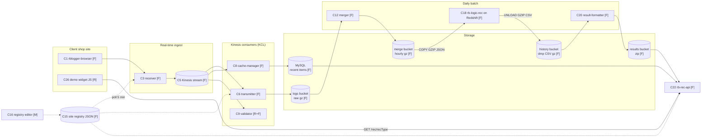
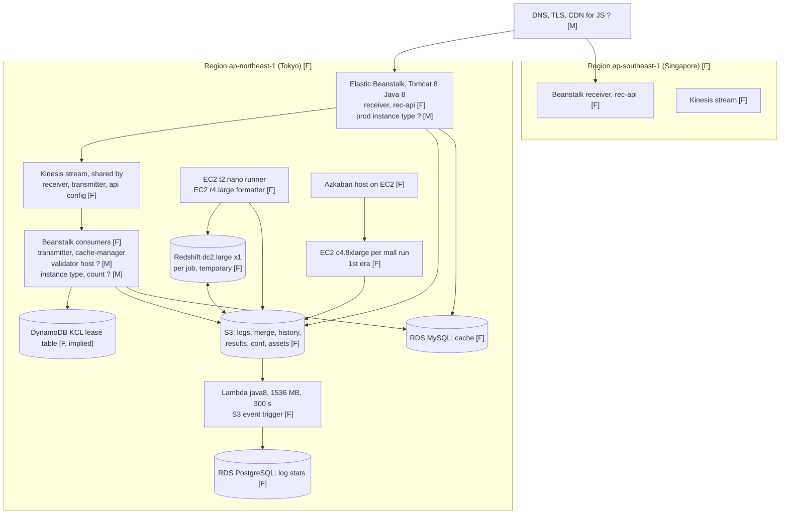
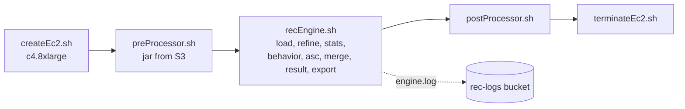
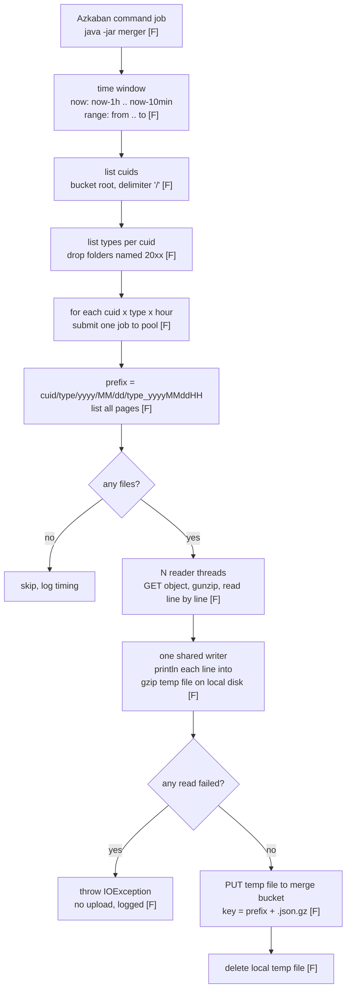
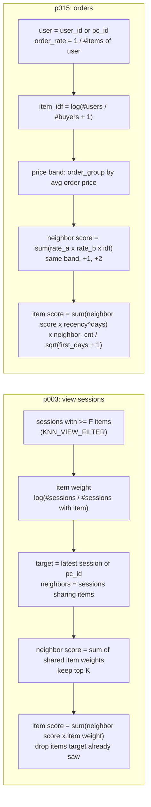
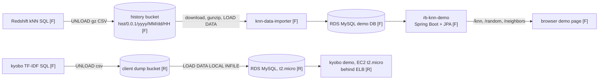

# Recobell 프로젝트 연재(project series) 설계

> 상태: 설계 초안 rev2 (system-architect, 2026-10-19). rev2 = 로그 병합기 §4.2.1 추가, rec-solution 글 7 → 8. 글, 코드, 그림, SQL 실행 없음. 선택은 오너가 한다.
> 위치 근거: 선례 `prettylog-series.design.md`, `projects.design.md`와 같은 루트 `*.design.md`다.
> `pg.plan.md`, `00.tasks.md`, `decisions.plan.md`는 product-manager(pm)와 main session이 고친다. 이 문서는 고치지 않는다.
> 원본 저장소: `~/Desktop/_job_recobell/` (읽기 전용). 이 문서의 원본 경로는 모두 그 아래 상대 경로다.
> 이 문서 자체도 비밀 제거본이다. 버킷, 호스트, 계정 번호, cuid는 자리표(placeholder)로만 쓴다 (§8.2).

## 0. 미션 블록 (인용)

> - Mission: 채용 담당자가 프로젝트 결과를 한눈에 보게 한다. (오너 승인 2026-10-13, #79)
> - Vision: 방문자가 `/@u/...` 한 체계에서 글, 프로젝트, 소개를 로그인 없이 읽는다. 옛 URL은 모두 새 URL로 연결된다. (오너 승인 2026-10-13, #79)

- 원본: `pg.plan.md` "Mission block" 13–14행. 이 연재용 `PLAN` 절은 아직 없다.
- 목표(goal) 초안 (오너 승인 전, pm이 plan에 옮긴다):
  - G-RB1: 연재 글이 `projects/recobell/rec-solution/`, `projects/recobell/knn-demo/` 아래 발행된다. 메뉴 Projects 배지(badge)는 4다.
  - G-RB2: 모든 인프라 상자에 출처 경로가 있다. 근거 없는 상자는 "from memory (owner)" 표시가 있다.
  - G-RB3: 발행 전 원고에서 §8.3 grep 결과가 0건이다.
- 전략 A/B/C는 이 연재에 없다. 그룹 모델(#119, S1 = A)과 공개 범위(#127)는 이미 정해졌다.

오너 요구 (verbatim, 2026-10-19):

> time to write about recobell: [rb-rec-engine, RBLogger, rb-logic-rec, rb-rec-api] for knn - knn-data-importer, rb-knn-demo, rb-rec-kyobo-demo. based on this I would like to have a project for recobell - recommendation solution - knn-demo for 2 projects under recobell work. I would like to have system design with infrastructure and rblogger - recengine - api and management with architecture and infrastructure in aws? also I would like to have a how to same logs in s3 and how to zip them and how to search them? design and plan first?

## 1. 결과 요약

| 결정 | 권고 |
| --- | --- |
| 그룹 행 | 빈 `company` 행(id 14)의 title을 `recobell`로 바꾼다. priority 20 유지 (§2.1) |
| 프로젝트 | `rec-solution` (글 8), `knn-demo` (글 3). 합계 11 |
| 연재 제목 | 기본 A "Recobell From the Logs Up" / 대안 B "Inside Recobell's Recommendation Pipeline" (§6.1) |
| 독자 | 채용 담당자(recruiter) 먼저, 엔지니어(engineer) 둘째 |
| 그림 | 글 안 mermaid 블록만 (#124). 측정 숫자가 없어서 차트(chart)는 없다 |
| 숫자 규칙 | 코드의 설정값(config)만 쓴다. 이력서 숫자는 "owner claim"으로 표시한다 |
| 인프라 | 상자마다 출처 경로. 코드에 없으면 "from memory (owner)" (§3.3) |
| S3 로그 글 | 저장(gzip, 키 배치) → 병합(merge) → 검색(prefix 나열, Redshift COPY) (§4) |
| 코드 변경 | i18n 키 2개 추가뿐. Express, 웹 코드 변경 0 (§7) |
| 비밀 | 원본에 비밀이 많다. AWS 키 패턴만 약 292개 파일 (§8.1) |
| 열린 질문 | 20개, 모두 기본값 있음 (§9). Q16–Q20은 병합기 (rev2) |
| 병합기 | `rblogger-merger`를 글 04로 따로 쓴다 (§4.2.1, rev2) |

```text
원본 7개 저장소 (읽기만) ──► 사실 표 §3, §4, §5 (경로 붙음)
                                │
                                ├─► rec-solution 00 ─► 01 ─► 02 ─► 03 ─► 04 ─► 05 ─► 06 ─► 07
                                └─► knn-demo     00 ─► 01 ─► 02
비밀 제거 §8 ──► 원고 grep 0건 ──► reviewer 1회 ──► SQL §7 ──► 발행 ──► purge ──► 확인
```

## 2. 목적과 Projects 배치

목적:

- 채용 담당자: 이력서 한 줄 "Recobell 02/2018–07/2019"를 구조 그림으로 본다 (`apps/dashboard_client_web/app/MainPage.tsx` 86–97행).
- 엔지니어: 수집(collect) → 저장(store) → 배치(batch) → 서빙(serve) 설계 이유를 본다.
- 선례: `my-work/prettylog`, `utrgv/cnn-from-scratch` 연재와 같은 틀이다. 그림 먼저, 키워드, 짧은 문장.

바뀐 뒤 카테고리 트리 (#127):

```text
projects/                       루트 (PROJECTS_ROOT_CATEGORY_TITLE)
├── my-work/      priority 10   "My Work"     prettylog
├── recobell/     priority 20   "Recobell"    ← 옛 company 행 (id 14), title만 바뀜
│   ├── rec-solution/           프로젝트, 글 8개 (00–07)
│   └── knn-demo/               프로젝트, 글 3개 (00–02)
├── adriel/       priority 25   "Adriel"      나중. 이 설계 밖 (Q12)
├── gatech/       priority 30   "GT MSCS"     비어 있어 숨김
└── utrgv/        priority 40   "UTRGV MSCS"  cnn-from-scratch
```

| 수준 | 이 연재 | URL |
| --- | --- | --- |
| 그룹 | `recobell` | `/@taeklim/projects#recobell` (앵커만, 경로는 404) |
| 프로젝트 | `rec-solution`, `knn-demo` | `/@taeklim/projects/rec-solution`, `/@taeklim/projects/knn-demo` |
| 글 | 11개 | `/@taeklim/<slug>` |

- 프로젝트 title은 그룹 사이에서도 유일하다. 오늘 `rec-solution`, `knn-demo` 행은 없다 (발행 전 SELECT로 확인, §7.1).
- 규칙 출처: 루트 `CLAUDE.md` "Projects: categories as groups", `projects.design.md` §12.3, §12.5.

### 2.1 그룹 행 결정: `company` → `recobell`

| 옵션 | 내용 | 행 변화 | 판정 |
| --- | --- | --- | --- |
| **A 이름 바꾸기 (권고)** | id 14의 `title`을 `company` → `recobell`로 `UPDATE`. priority 20 그대로 | 0행 추가, 0행 tombstone | **고름** |
| B 새 행 + tombstone | `recobell` 그룹 INSERT, `company` 행에 `deleted_at` | 1행 추가, 1행 tombstone | 버림 |
| C 그대로 두기 | 새 `recobell` 그룹을 blog_agent가 발행 때 만든다 | 발행이 1행 추가 | 버림 |

A를 고른 이유:

- `company`는 비어 있다. 자식이 없어서 화면에서 이미 숨는다 (`projects.design.md` §12.3 표 3행).
- 오너 순서(My Work → Company 자리 → GT → UTRGV)에서 recobell이 Company 자리 20을 그대로 쓴다.
- adriel도 자기 그룹이 된다 (#127). 그래서 일반 이름 `company` 행은 어차피 쓸 곳이 없다.
- SQL 한 줄이다. 되돌리기도 한 줄이다 (title을 `company`로).
- 행 id가 그대로라 tree, 정렬, 캐시 키에 새 id가 생기지 않는다.

B를 버린 이유:

- 같은 결과에 행이 둘 움직인다. tombstone 행이 영구히 남는다.
- 새 id를 `generate_id()` 형식으로 만들어야 한다 (`projects.design.md` §12.6).

C를 버린 이유:

- blog_agent는 `(user_id, parent_id, title)`로 upsert한다 (`projects.design.md` §12.6).
- 그러면 priority 기본값을 가진 `recobell` 행이 새로 생긴다. 순서가 오너 순서와 어긋날 수 있다.
- 빈 `company` 행도 그대로 남는다.

공통 함정:

- SQL(§7.1)은 첫 발행 **전에** 돈다. 순서가 바뀌면 C와 같은 결과가 된다.
- i18n은 `recobell`, `adriel` 키만 더한다. `company` 키는 지우지 않는다 (§12.5 "키 추가만"). 쓰이지 않지만 해가 없다.

## 3. 시스템 지도 (코드 근거)

- 표시 규칙: **F** = 코드, 설정, 스크립트가 보여 주는 사실. **R** = README만 말하는 사실. **M** = "from memory (owner)". M은 §9 열린 질문에 있다.
- 숫자는 설정값(config)만 쓴다. 트래픽, 지연(latency), 비용 같은 측정값은 원본에 없다.
- 회사 이름 "Warren"은 저장소 묶음 이름이다 (`Warren/rb-warren-airflow/README.md` 3행). 제품 이름인지는 Q4.

### 3.1 구성 요소 표

| # | 구성 요소 | 하는 일 | 근거 | 출처 경로 |
| --- | --- | --- | --- | --- |
| C1 | `rblogger-browser` (JS/TS 수집기) | 쇼핑몰 페이지에서 이벤트를 보낸다. 방문자 쿠키 `RB_PCID`를 만든다 | F | `RBLogger/rblogger-client/rblogger-browser/src/rblpcidgen.ts` 3–10행, `src/rbl-config-apne1.js` 3행 |
| C2 | 스크립트 배포 | grunt `aws_s3` 작업으로 정적 버킷에 올린다 | F | `RBLogger/rblogger-client/rblogger-browser/Gruntfile.js` 79–87, 153행 |
| C3 | `rblogger-receiver` | `POST /rest/logs` 또는 `GET /rest/logs` (1×1 gif 응답). 검사 → 서버 정보 추가 → Kinesis | F | `RBLogger/rblogger-receiver/src/main/java/com/recobell/logger/receiver/RBReceiverController.java` 50–87행 |
| C4 | 수신 검사 | `cuid`, `type`이 있고 `cuid`가 등록 사이트일 때만 받는다. `serverTime`(UTC), IP, User-Agent를 붙인다 | F | `.../receiver/JsonHandler.java` 33–49행 |
| C5 | Kinesis 스트림(stream) | 리전(region)마다 설정된 스트림 이름 하나. 파티션 키(partition key) = `pcId`, 없으면 현재 ms | F | `.../receiver/KinesisRecordSender.java` 32–50행, `src/main/resources/apne1/application.properties` 12–16행 |
| C6 | `rblogger-transmitter` | Kinesis 소비(KCL) → 로컬 H2 큐 표 → gzip → S3 | F | `RBLogger/rblogger-transmitter/src/main/java/com/recobell/logger/transmitter/` 아래 `transmit/record/TransmitRecordProcessor.java`, `RdbTransmitRecordQueue.java`, `emitter/s3/S3TransmitRecordEmitter.java` |
| C7 | KCL 체크포인트 표 | KCL 라이브러리가 DynamoDB 표에 진행을 적는다 | F (코드 주석) | `.../transmit/record/TransmitRecordProcessor.java` 202–206행 |
| C8 | `rblogger-cache-manager` | Kinesis 소비 → MySQL에 사용자별 최근 항목 30개 (쉼표 목록). 10분마다 만료 삭제 | F | `RBLogger/rblogger-cache-manager/src/main/java/com/recobell/logger/cachemanager/jdbc/RdbCacheGlossary.java` 9–80행, `CacheExpirerConfig.java` 24행, `src/main/resources/apne1/application.properties` 26–29행 |
| C9 | `rblogger-validator` | Kinesis 소비. 로그 검사, 종류별 시간 통계 | R + F | `RBLogger/rblogger-validator/README.md` 3–4행, `ValidatorController.java` 25–51행 |
| C10 | `rblogger-file-validator` | S3 이벤트로 도는 Lambda. 파일 검사 통계를 RDS PostgreSQL에 쓴다 | F | `RBLogger/rblogger-file-validator/create-lambda.sh` 9–18행, `src/main/java/com/recobell/logger/S3LogValidationHandler.java` 18–23행, `src/main/resources/application.yml` 21–28행 |
| C11 | 검사 규칙 | 5종 로그(visit, view, search, order, product)의 필수 칸, 정규식, 열거형 | F | `RBLogger/rblogger-validator-core/src/main/resources/basic-commerce-rules.json` 1–112행 |
| C12 | `rblogger-merger` | 시간 단위 작은 gz 파일을 하나로 합친다. Azkaban 명령 작업 | F | `RBLogger/rblogger-merger/src/main/java/com/recobell/logger/merger/S3LogFileMerger.java` 77–150행, `build-prod.sh` 9–17행 |
| C13 | `rblogger-metadata-updater` | Kinesis 소비 → MySQL `metadata` upsert (2017) | F | `RBLogger/rblogger-metadata-updater/src/main/java/com/recobell/updater/MetadataRecordEmitter.java` 33행 |
| C14 | `rblogger-issuer` | `GET /user/guid` 식별자 발급 | F | `RBLogger/rblogger-issuer/src/main/java/com/recobell/logger/issuer/IssuerController.java` 30행 |
| C15 | 사이트 등록부(site registry) | 사이트 마스터 데이터. S3의 JSON 1개. 각 서비스가 5분마다 읽고 `lastModified`가 바뀌면 다시 싣는다 | F | `recobell/optima-mds/src/main/java/com/recobell/optima/masterdata/Site.java` 13–42행, `recobell/optima-mds-s3/src/main/java/com/recobell/optima/metadata/S3SyncingSitesHolder.java` 64–74행, `.../transmitter/TransmitterApplication.java` 172–176행 |
| C16 | 등록부를 쓰는 관리 화면 | JSON을 누가 쓰는지 코드에 없다 | **M** | 없음 (Q3) |
| C17 | `rb-rec-engine` (1세대 배치) | 사이트마다 EC2를 띄운다. 로컬 PostgreSQL에 로그를 싣고 SQL 단계를 돌린다. 결과를 S3로 | F | `Warren/rb-rec-engine/readme.md` 2–3행, `rb-rec-engine/src/main/java/com/recobell/rec/AbstractRecEngine.java` 170–232행, `rb-rec-pgsql/releases/espoir/application.properties` 6–7, 39–49행 |
| C18 | `rb-logic-rec` (2세대 배치) | Redshift SQL 스크립트. COPY → 계산 → UNLOAD (gz CSV) | F | `Warren/rb-logic-rec/media/0.2.5/base/02load-data.sql` 11–25행, `09unload.sql` 15–26행 |
| C19 | dptasks 묶음(bundle) | 하루 1회 일정. 임시 Redshift + EC2 2대를 정의한다 | F | `Warren/rb-dpt-bundle/commerce-rec/rec/commerce-rec-task-bundle-kyobobook-live.json` 5–8, 24–39행 |
| C20 | `rb-rec-result-formatter` | dmp CSV → 키마다 gz JSON → 해시 묶음 zip → S3 | F | `Warren/rb-rec-result-formatter/src/main/java/com/recobell/rec/formatter/postprocessor/S3HashPostProcessor.java` 41–76행 |
| C21 | 결과 키 규칙 | `<cuid>/<recType>/<hash>.zip`, 그 안에 `base64(id).json.gz` | F | `Warren/rb-data-models/src/main/java/com/recobell/model/rec/RecResults.java` 93–136행 |
| C22 | `rb-rec-api` | `GET /rec/{recType}`. JSONP 응답. S3 zip에서 결과를 읽는다 | F | `Warren/rb-rec-api/src/main/java/com/recobell/rec/api/RecApiServerController.java` 46–106행, `S3HashRawRecResultGetter.java` 167–206행, `RecApiControllerAdvice.java` 89–90행 |
| C23 | API 실시간 보정 | C8의 MySQL에서 사용자 최근 본 항목을 읽는다 | F | `Warren/rb-rec-api/src/main/java/com/recobell/rec/api/RdbCacheGetter.java` 39–109행 |
| C24 | API 노출 로그 | `type=recommend` 로그를 Kinesis로 보내는 코드가 있다. 호출하는 곳은 찾지 못했다 | F (미사용) | `.../rec/api/RecommendationsLog.java` 8행, `RecommendationsLogBuilder.java` 19행 |
| C25 | `rb-warren-dashboard` | 로그인 화면. 사이트 목록, 사이트·종류별 로그 미리 보기 | F | `Warren/rb-warren-dashboard/src/main/java/rb/warren/dashboard/RbWarrenDashboardApplication.java` 24–47행, `S3LogLoader.java` 120–143행 |
| C26 | `rb-warren-web` | 사이트별 데모 HTML, CSS, JS. S3 정적 웹사이트 | R | `Warren/rb-warren-web/README.md` 6–10행 |
| C27 | `rb-warren-airflow` | Airflow 작업 관리자 (docker). 언제 dptasks를 대신했는지 코드에 없다 | R + **M** | `Warren/rb-warren-airflow/README.md` 3행, `ecs/README.md` 4행 (Q5) |

- 원본 범위: 오너 목록 7개 + 보조 6개 (`optima-mds`, `optima-mds-s3`, `rb-data-models`, `rb-dpt-bundle`, `rb-rec-result-formatter`, `rb-warren-dashboard`). 보조는 흐름의 빈칸을 채우는 데만 쓴다. 보조를 쓸지는 Q2.
- 귀속(attribution): `rb-rec-engine` 마지막 커밋은 2016-03이다. 오너 재직은 2018-02부터다. 그래서 "물려받아 유지하고 넓힌 시스템"으로 쓴다. 오너가 직접 만든 부분은 오너가 이름을 댄다 (Q1).

### 3.2 데이터 흐름 (아키텍처 그림)

- 상자 이름 끝 `[F]`, `[R]`, `[M]`은 §3 표시 규칙이다. 상자 번호는 §3.1의 C 번호다.
- 이 그림은 rec-solution 00 글의 F-RS00a 원본이다.



| 흐름 | 단위 | 언제 | 출처 |
| --- | --- | --- | --- |
| 브라우저 → receiver | JSON 이벤트 1개 | 페이지 이벤트마다 | C3 |
| receiver → Kinesis | 레코드 1개, 키 = `pcId` | 즉시 | C5 |
| transmitter → S3 | `(cuid, type)`마다 gz 파일 1개 | 30분마다 또는 큐가 차면 | §4.1 |
| merger → merge bucket | `(cuid, type, 시간)`마다 gz 1개 | Azkaban 작업, 기본 "직전 1시간" | §4.2.1 |
| Redshift COPY | 시간 파일 여러 개 | 배치 시작 | §4.3 |
| UNLOAD → formatter → API | 추천 종류마다 zip 묶음 | 하루 1회 (C19 `period: 1d`) | §4.4 |
| cache-manager → API | 사용자별 최근 30개 | 실시간 | C8, C23 |

### 3.3 AWS 인프라 그림

- 값이 코드에 있으면 적는다. 없으면 "?"와 `[M]`이다. 자리표는 §8.2다.
- 이 그림은 rec-solution 01 글의 F-RS01a 원본이다.



| 상자 | 사실 | 출처 |
| --- | --- | --- |
| 리전 2개 (apne1, apse1) | F | `RBLogger/rblogger-receiver/pom.xml` 177, 205행, `Warren/rb-rec-api/pom.xml` 222, 293행 |
| Beanstalk 플랫폼 Tomcat 8 Java 8 | F | `RBLogger/rblogger-receiver/pom.xml` 31행, `Warren/rb-rec-api/pom.xml` 48행 |
| Beanstalk 인스턴스 t2.micro / t2.nano, SingleInstance | F, **test 프로필만** | `RBLogger/rblogger-receiver/pom.xml` 146–149행, `Warren/rb-rec-api/pom.xml` 177–180행 |
| Beanstalk 운영 인스턴스 종류, 대수, 자동 확장(autoscaling) | **M** | 운영 프로필에 값 없음 (Q6) |
| rec-api gzip 응답 (Apache `mod_deflate`) | F | `Warren/rb-rec-api/src/main/ebextensions/myapp.config` 1–11행 |
| Kinesis 생산(KPL), 소비(KCL) | F | `.../receiver/RecordSenderConfig.java` 33–48행, `.../transmitter/TransmitterApplication.java` 99–114행 |
| 소비자도 Beanstalk로 배포 | F | `RBLogger/rblogger-transmitter/mvn-eb-create.sh`, `RBLogger/rblogger-cache-manager/mvn-eb-create.sh`, `RBLogger/rblogger-server/pom.xml` 75행 |
| 소비자 인스턴스 종류, 대수. validator(gradle, 배포 스크립트 없음)가 돌던 곳 | **M** | 운영 값 없음 (Q6) |
| 스트림 이름 하나를 receiver, transmitter, rec-api 설정이 같이 쓴다 | F | 각 `src/main/resources/apne1/application.properties`의 stream 키. 리전에 스트림이 몇 개였는지는 M |
| Lambda | F | `RBLogger/rblogger-file-validator/create-lambda.sh` 9–18행 |
| RDS MySQL (cache), RDS PostgreSQL (stats) | F | `RBLogger/rblogger-cache-manager/src/main/resources/apne1/application.properties` 26–29행, `RBLogger/rblogger-file-validator/src/main/resources/application.yml` 27행 |
| Redshift dc2.large 1노드, EC2 t2.nano, r4.large | F | `Warren/rb-dpt-bundle/commerce-rec/rec/commerce-rec-task-bundle-kyobobook-live.json` 24–39행 |
| 임시 EC2 c4.8xlarge, Azkaban 호스트 | F | `Warren/rb-rec-engine/rb-rec-pgsql/releases/scripts/createEc2.sh` 31–34행, `uploadBash2Azkaban.sh` 3–5행 |
| DNS, TLS 인증서, 수집 JS용 CDN | **M** | 호스트 이름은 있으나 공급자 근거 없음 (Q7) |
| VPC, 보안 그룹 구성 | **M** | 스크립트에 그룹 id만 있다 (Q7) |

### 3.4 두 시대(era)의 배치(batch)

원본 트리에 배치 방식이 둘 있다. 둘 다 사실이다.

| 칸 | 1세대 (2015–2016) | 2세대 (2017–2019) |
| --- | --- | --- |
| 계산 엔진 | 임시 EC2 안의 로컬 PostgreSQL (datasource가 localhost) | 임시 Redshift 클러스터 1노드 |
| 로그 입력 | S3 날짜 prefix 나열 → Java 적재기 | Redshift `COPY ... GZIP FORMAT AS JSON` + jsonpaths |
| 로직 | Java가 SQL 파일 순서대로 실행 (`00s`–`08d`) | `ypsql-runner`가 SQL 스크립트 실행 (`--#var`, `--#foreach` 지시어) |
| 결과 출력 | Java가 S3에 JSON 직접 쓰기 | UNLOAD gz CSV → formatter → zip |
| 일정 | Azkaban 셸 단계 5개 | dptasks JSON 묶음, `period: 1d` |
| 출처 | `Warren/rb-rec-engine/rb-rec-pgsql/releases/scripts/*.sh`, `AbstractRecEngine.java` 170–232행 | `Warren/rb-logic-rec/**/0*.sql`, `Warren/rb-dpt-bundle/commerce-rec/rec/*.json` |

1세대 단계 (rec-solution 05 글의 F-RS05a 원본):



- 단계 이름 출처: `AbstractRecEngine.java` 175–231행, `rb-rec-pgsql/src/main/resources/sql/` 파일 이름.
- 로그 창(window): view 7일, order 30일, product 7일 (설정값, `releases/espoir/application.properties` 41–43행).
- 결과 크기 상한: a 계열 40, c 계열 40, m 계열 1000 (설정값, 같은 파일 47–49행).
- 이전 실행의 표는 gz CSV로 S3에 덤프(dump)하고 다음 실행이 다시 싣는다 (`AbstractRecEngine.java` 242–289행).
- 2세대가 1세대를 언제, 어디서 대신했는지는 원본이 말하지 않는다 (Q5).

## 4. S3 로그: 저장 → 압축 → 검색

무엇을 알려고 쓰나: 하루 수백만 이벤트를 싸게 두고, 배치가 필요한 범위만 빨리 읽는 법.
이 절은 rec-solution 03 글(S3 키 배치와 검색)과 04 글(병합기, §4.2.1)의 원본이다.

```text
event JSON ─► Kinesis ─► transmitter queue ─► gzip ─► logs bucket
                         (30 min / 80 MB / 60k)      <cuid>/<type>/yyyy/MM/dd/<type>_yyyyMMddHH_<shard>_<seq>.json.gz
                                                          │  merger, hourly
                                                          ▼
                                                     merge bucket
                                                     <cuid>/<type>/yyyy/MM/dd/<type>_yyyyMMddHH.json.gz
                                                          │  "search" = build the prefix from (cuid, type, date)
                          ┌───────────────────────────────┼───────────────────────────┐
                          ▼                               ▼                           ▼
                Redshift COPY GZIP JSON        rec-engine prefix list        dashboard peek
                (2nd era)                      (1st era)                     (first line, 10 files)
```

### 4.1 저장 (save)

| 항목 | 값 | 근거 | 출처 |
| --- | --- | --- | --- |
| 파일 형식 | 한 줄에 JSON 하나 (JSON Lines), UTF-8 | F | `RBLogger/rblogger-transmitter/src/main/java/com/recobell/logger/transmitter/util/BytaUtils.java` 16–26행 |
| 폴더 키 | `<cuid>/<type>/yyyy/MM/dd/` (UTC) | F | `.../transmitter/util/LogFileNames.java` 22, 52–57행 |
| 파일 이름 | `<type>_yyyyMMddHH_<shardId>_<minSeqNum>.json.gz` | F | 같은 파일 70–72행 |
| 버킷 | 사이트마다 등록부의 `bucket` 칸 | F | `.../emitter/s3/S3TransmitRecordEmitter.java` 55, 81–83행 |
| 파일을 쓰는 때(rotation) | 30분마다, 또는 큐가 80,000,000 bytes / 60,000 records를 넘을 때 | F (설정값) | `.../transmit/record/TransmitRecordProcessor.java` 49–50, 106–108행, `src/main/resources/apne1/application.properties` 20–21행 |
| 큐 | 프로세스 안 H2 표. `(cuid, type)`으로 묶어 파일 하나씩 | F | `.../transmit/record/RdbTransmitRecordQueue.java` 38–47, 158–166행, `pom.xml` 84–86행 |
| 쓴 뒤 | S3 put 성공 → 큐 비움 → Kinesis 체크포인트 | F | `TransmitRecordProcessor.java` 182–189행 |

설계 이유 (글에 쓸 것):

- 키 맨 앞이 `cuid`다. 사이트 하나의 로그가 한 prefix 아래 모인다.
- 그다음 `type`, 그다음 날짜다. 배치는 "사이트 × 종류 × 날짜 범위"로 읽는다 (§4.3).
- 파일 이름에 `shardId`와 첫 순번(`minSeqNum`)이 있다. 여러 소비자가 같은 시간에 써도 이름이 겹치지 않는다.
- 체크포인트는 S3 쓰기 **뒤**다. 중간에 죽으면 다시 읽는다. 그래서 중복은 생길 수 있고 유실은 줄어든다 (at-least-once, 최소 한 번 전달).

코드에서 보이는 함정 (글의 "what I'd change" 칸):

- 파일 시각은 이벤트 시각이 아니다. 쓰는 순간의 `now(UTC)`다 (`S3TransmitRecordEmitter.java` 61행). 30분 묶음이라 한 시간 파일에 앞 시간 이벤트가 섞일 수 있다.
- `DualRecordEmitter`는 같은 파일을 종류 폴더와 날짜 폴더에 두 번 쓴다 (`S3TransmitDualRecordEmitter.java` 69–98행). 그러나 팩토리는 `SingleRecordEmitter`를 쓴다 (`TransmitRecordProcessorFactory.java` 43행). 운영에서 어느 쪽이었는지는 Q8.
- 협력사 설정(`CompanyConfig`)이면 폴더 형식이 `yyyyMM/dd`와 `logs_<type>`으로 바뀐다 (`LogFileNames.java` 23, 56행). 글에는 "per-tenant key format"으로만 쓴다.

### 4.2 압축 (zip): gzip 두 번, 합치기 한 번

| 단계 | 무엇 | 근거 | 출처 |
| --- | --- | --- | --- |
| 1 쓰기 압축 | 메모리에서 줄 묶음 → `GZIPOutputStream` → S3 put | F | `BytaUtils.java` 31–39행 |
| 2 시간 병합 | 한 시간의 작은 gz 파일을 모두 풀어 줄을 이어 쓰고 다시 gzip | F | `RBLogger/rblogger-merger/src/main/java/com/recobell/logger/merger/S3LogFileMerger.java` 77–150행 |
| 병합 입력 prefix | `<cuid>/<type>/yyyy/MM/dd/<type>_yyyyMMddHH` (그 시간의 모든 shard 파일) | F | 같은 파일 78–80행 |
| 병합 출력 | 다른 버킷(merge bucket), 이름 `<type>_yyyyMMddHH.json.gz` | F | 같은 파일 82, 96행 |
| 병합 범위 | 모드 `now` = 직전 1시간. 모드 `range` = 날짜 범위 재처리 | F | `RBLogger/rblogger-merger/src/main/resources-prod/application.yml` 13–16행, `Application.java` 68–83행 |
| 실행 | Azkaban `type=command` 작업 zip | F | `RBLogger/rblogger-merger/build-prod.sh` 9–17행 |
| 압축률 | 코드 주석 "약 1/10" | **주석, 측정 아님** | `BytaUtils.java` 29행 |

- 왜 합치나: COPY와 목록(list) 호출은 파일 수에 비례한다. 시간당 한 파일이면 경로를 계산으로 바로 만든다 (§4.3).
- 병합은 파일마다 풀어서 줄을 이어 쓰고 다시 압축한다 (같은 파일 128–137행).
- 압축률 "1/10"은 글에서 "code comment, not measured"로 표시한다. 이 수를 제목에 쓰지 않는다.

#### 4.2.1 로그 병합기(log aggregator): 작은 gz 파일이 한 시간 파일이 되는 법

오너 추가 요청 (verbatim, 2026-10-19):

> there is also a log aggregator and its logic is important how to zip logs

- 병합기 = `RBLogger/rblogger-merger` (C12). 작성일 주석 2016-01-08 (`S3LogFileMerger.java` 34–38행).
- 이 절은 rec-solution 04 글(병합기 전용)의 원본이다. 아래 경로는 모두 `RBLogger/rblogger-merger/` 기준이다.
- 줄여 쓴 경로: `M` = `src/main/java/com/recobell/logger/merger/S3LogFileMerger.java`, `A` = `.../merger/Application.java`, `D` = `.../merger/DateConfig.java`.

무엇을 알려고 쓰나: 소비자 여러 개가 30분마다 쓴 조각 파일을, 배치가 한 경로로 읽는 한 시간 파일로 바꾸는 법.



단계별 (모두 F, 경로와 행):

| # | 단계 | 코드가 하는 일 | 출처 |
| --- | --- | --- | --- |
| 1 | 실행 | Spring Boot 앱이 `run()` 한 번 돌고 끝난다. Azkaban `type=command` 작업으로 묶는다 | `A` 26–31행, `build-prod.sh` 9–17행 |
| 2 | 시간 창 `now` | 시작 = 지금(UTC) − 1시간, 끝 = 지금 − 10분 | `D` 26–52행 |
| 3 | 시간 창 `range` | 설정의 `from`, `to`를 그대로 쓴다. 재처리(backfill)용 | `D` 33–35, 47–49행, `src/main/resources-prod/application.yml` 13–16행 |
| 4 | 시간 순회 | 시작부터 1시간씩 더하며 끝 전까지. `now` 모드면 보통 직전 시간 1개 | `A` 68–83행 |
| 5 | 사이트 찾기 | 원시 버킷 맨 위를 `/` 구분자로 나열 → 폴더 이름 = cuid | `M` 61–65행 |
| 6 | 종류 찾기 | `<cuid>/` 아래 폴더 나열. 이름이 `20xx`인 폴더(종류 없는 날짜 폴더)는 뺀다 | `M` 67–75행 |
| 7 | 묶음 키 | `(cuid, type, hour)` 하나가 작업 하나. 바깥 풀(pool) 크기 = `threads` | `A` 64–79행 |
| 8 | 입력 prefix | `<cuid>/<type>/yyyy/MM/dd/<type>_yyyyMMddHH`. 그 시간의 모든 shard 조각이 맞는다 | `M` 78–80행 |
| 9 | 나열 | 페이지가 잘리면(`isTruncated`) 다음 페이지를 계속 받는다. 출력과 같은 이름은 뺀다 | `M` 104–119행 |
| 10 | 읽기 | 조각마다 스레드 1개. S3 스트림 → `GZIPInputStream` → `Scanner`로 한 줄씩. 파일 전체를 메모리에 올리지 않는다 | `M` 129–137행 |
| 11 | 쓰기 | 공유 `PrintWriter` 하나 → `BufferedWriter` → `GZIPOutputStream` → 로컬 임시 파일 `rblog*json.gz`. 줄마다 `println` | `M` 125–138행 |
| 12 | gzip 설정 | 압축 수준, 버퍼 크기를 코드가 정하지 않는다. Java 기본값이다 | `M` 128행 |
| 13 | 내부 풀 크기 | 생성자 기본 10. 운영 설정 `merger.threads: 20`이 덮는다 | `M` 47, 56–59행, `A` 60행, `resources-prod/application.yml` 17–18행 |
| 14 | 실패 | 조각 하나라도 못 읽으면 목록에 모은다 → 끝에 `IOException` → 업로드하지 않는다. 바깥에서 로그만 남긴다 | `M` 139–150행, `A` 73–77행 |
| 15 | 출력 | 다른 버킷(`<merge-bucket>`)에 PUT. 키 = 입력 prefix + `.json.gz` | `M` 82, 95–97행 |
| 16 | 정리 | 업로드 뒤 로컬 임시 파일을 지운다 | `M` 97행 |
| 17 | 원본 조각 | 지우지 않는다. 코드에 S3 삭제 호출이 없다 (RBLogger 전체 grep `deleteObject` 0건) | `M` 전체 |

키 배치 전과 후:

| 칸 | 전 (원시, `<logs-bucket>`) | 후 (병합, `<merge-bucket>`) |
| --- | --- | --- |
| 키 | `<cuid>/<type>/yyyy/MM/dd/<type>_yyyyMMddHH_<shardId>_<minSeqNum>.json.gz` | `<cuid>/<type>/yyyy/MM/dd/<type>_yyyyMMddHH.json.gz` |
| 한 시간당 파일 수 | 여러 개 (shard 수 × 쓰기 횟수 × 소비자 수) | 1개 |
| 이름 계산 | shard, 순번을 알아야 한다 → 나열 필요 | `(cuid, type, hour)`만으로 계산된다 |
| 읽는 쪽 | 1세대 엔진의 날짜 prefix 나열 (§4.3 S1) | 2세대 Redshift COPY 정확한 경로 (§4.3 S2) |
| 출처 | `.../transmitter/util/LogFileNames.java` 52–72행 | `M` 78–82행, `Warren/rb-logic-rec/media/0.2.5/base/02load-data.sql` 17행 |

설계 성질 (코드에서 읽은 것):

- 다시 돌려도 안전하다(re-run safe). 출력 키가 고정이라 같은 시간을 다시 돌리면 덮어쓴다. 원본 조각은 그대로 남아 있다.
- 부분 출력이 없다. 임시 파일이 다 쓰인 뒤 PUT 한 번이다. 읽기 실패면 PUT 자체를 하지 않는다.
- 메모리는 줄 단위다. 크기 상한은 로컬 디스크다 (임시 파일).
- 줄 순서는 지키지 않는다. 여러 스레드가 한 writer에 줄을 끼워 넣는다 (`M` 131–137행). COPY는 줄 순서와 무관하다.
- 늦게 온 조각: `now` 모드는 직전 시간을 한 번만 본다. 그 뒤에 그 시간 이름으로 쓰인 조각은 `range` 재실행 전까지 병합본에 없다. 다만 조각 이름은 쓰는 순간의 시각이라(§4.1) 지난 시간 이름으로 늦게 쓰이는 경우는 드물다.

코드 읽기로 보이는 약점 (글 04의 "What I'd change", 측정 아님):

- `Scanner`는 읽기 중 `IOException`을 삼킨다 (Java API 동작). 잘린 gz 조각이면 일부 줄만 들어가고 실패로 잡히지 않을 수 있다 (`M` 134–136행).
- 실패 목록 `failList`가 여러 스레드가 함께 쓰는 `LinkedList`다 (`M` 126, 140행). 동시 추가에 안전하지 않다.
- 실패 때 임시 파일을 지우지 않는다 (삭제는 성공 경로 97행에만 있다).
- 사이트 나열(5단계)은 페이지를 넘기지 않는다 (`M` 62행). 최상위 폴더가 1,000개를 넘으면 빠진다. 시간 나열(9단계)은 넘긴다.
- 바깥 풀은 `awaitTermination(1, DAYS)`다 (`A` 86–87행). 걸린 작업 하나가 하루를 막을 수 있다.

코드가 말하지 않는 것 ([M], §9 Q16–Q19):

- 왜 합쳤나: README는 "merge small logs file into one file"뿐이다 (`README.md` 3행). Redshift COPY 비용, S3 나열 비용 같은 이유는 코드에 없다 (Q16).
- 일정: 몇 분마다 돌았는지 Azkaban 일정이 원본에 없다 (Q17).
- 원본 조각과 병합본의 보관 기간, S3 수명 주기(lifecycle) 규칙: 원본에 없다 (Q18).
- 2세대 이후에도 이 병합기가 돌았는지: 2세대 SQL이 merge 경로를 읽으므로 돌았다고 보인다. 운영 확인은 Q19.

주변 저장소 판정:

| 저장소 | 판정 | 근거 |
| --- | --- | --- |
| `recobell/rb-cauly-log-merger` | 판정 불가. 코드 없음 | 파일은 `readme.md` 하나, 내용 "#Introduction" 한 줄 (`recobell/rb-cauly-log-merger/readme.md` 1행). 이름으로는 광고 매체 Cauly용 병합기로 보인다. 1세대 엔진에 `51d-ad-cauly.sql`이 있다. 같은 틀인지는 Q20 |
| `RecobellUtil/aws-utils` | 무관 (병합 아님) | S3, gzip 코드가 없다. 임시 Redshift 클러스터를 만들고, CloudWatch로 상태를 보고, 지우는 도구다 (`RecobellUtil/aws-utils/src/main/java/com/yx/jdbc/redshift/RedshiftManager.java` 91–137, 139–146, 204행). §3.4 2세대 "임시 Redshift"의 근거로 쓸 수 있다 (Q2) |
| `RBLogger/rblogger-server/rblogger-transmitter` | 같은 틀, 옛 사본 | 같은 `BytaUtils` gzip 코드가 있다 (`RBLogger/rblogger-server/rblogger-transmitter/src/main/java/com/recobell/logger/transmitter/BytaUtils.java`) |

### 4.3 검색 (search): prefix가 색인(index)이다

오너 목록 7개 저장소에는 Athena, EMR, 로그 검색 서버가 없다 (grep 0건). "검색"은 키를 계산해서 읽는 방식이다.

- 예외 1건: 보조 저장소 `Warren/rb-logic-rec-report/0.0.5/base/08unload-keyword-result.sql` 19–21행.
- 주석 "for Athena long-tail keyword table"이 있다. UNLOAD 경로가 Hive식 파티션(partition) `cuid=<cuid>/year=<y>/month=<m>/`이다.
- 대상은 원시 로그가 아니라 검색어 통계 표다. 원시 로그를 Athena로 찾았는지는 Q10.
- 글 03은 이 대비를 한 줄로 쓴다: "date-path keys for batch reads, Hive partitions for ad-hoc SQL".

| 방식 | 질문 | 어떻게 | 출처 |
| --- | --- | --- | --- |
| S1 날짜 prefix 나열 (1세대) | 사이트 X의 view, 지난 7일 | 날짜를 하루씩 빼며 `listObjects(<cuid>/<type>/yyyy/MM/dd/)` → 파일마다 스레드로 적재 | `Warren/rb-rec-engine/rb-rec-engine/src/main/java/com/recobell/rec/loader/S3JsonFiles2DbLoader.java` 99–151행 |
| S2 정확한 경로 COPY (2세대) | 사이트 X의 view, 직전 3시간 | 시간마다 merge 경로를 만든다 → Redshift `COPY ... GZIP FORMAT AS JSON '<jsonpaths>'` | `Warren/rb-logic-rec/media/0.2.5/base/02load-data.sql` 11–25행 |
| S3 날짜 폴더 COPY | 지난 N일 order | 폴더 prefix 하나를 COPY (그 날 파일 전부) | `Warren/rb-logic-rec/commerce-basic/0.0.7/base/21knn-refine.sql` 142–156행 |
| S4 칸 고르기 | JSON 중 쓸 칸만 | jsonpaths 파일이 칸 순서를 정한다 (예: view 28칸) | `Warren/rb-logic-rec/jsonpath/commerce-basic/0.0.6/view_data.jsonpaths` 1–32행 |
| S5 이력 찾기 | 가장 최근 결과 덤프 | 지금부터 한 시간씩 거슬러 `--#tryeach ... until succeed` | `02load-data.sql` 45–60행 |
| S6 미리 보기 | 이 사이트 로그가 들어오나 | `<cuid>/<type>/` 나열 → 수정 시각 순 10개 → 첫 줄 | `Warren/rb-warren-dashboard/src/main/java/rb/warren/dashboard/S3LogLoader.java` 120–143행 |

pseudo-code (글 03에 넣을 수준, 실제 코드 아님):

```text
for day in range(end, start, -1 day):          # S1
    for obj in list(bucket, f"{cuid}/{type}/{day:%Y/%m/%d}/"):
        load(gunzip(obj)) into staging table

for h in 1..3:                                  # S2
    t = now_utc - h hours
    COPY tmp_log_view FROM f"s3://<merge-bucket>/{cuid}/view/{t:%Y/%m/%d}/view_{t:%Y%m%d%H}.json.gz"
         GZIP FORMAT AS JSON '<jsonpaths>' MAXERROR 100000
```

- `MAXERROR 100000`: 깨진 줄이 있어도 적재를 멈추지 않는다 (같은 파일 24행). 검사 통계는 C9, C10이 따로 낸다.
- 검사 통계 저장소(RDS PostgreSQL)는 "로그 품질 검색" 역할이다. 화면이 있었는지는 Q3.

### 4.4 결과 쪽 zip: 해시 묶음 (hash bucketing)

로그 글 03의 마지막 절이고, 06 글이 다시 쓴다. 오너가 말한 "zip"이 이것일 수도 있다 (Q9).

| 항목 | 값 | 출처 |
| --- | --- | --- |
| 키 | `<cuid>/<recType>/<bucket>.zip` | `Warren/rb-data-models/src/main/java/com/recobell/model/rec/RecResults.java` 93–108행 |
| zip 안 항목 | `base64(id).json.gz` | `Warren/rb-rec-api/src/main/java/com/recobell/rec/api/S3HashRawRecResultGetter.java` 178–189행 |
| 묶음 수 | `d = N / 20` → `2 × highestOneBit(d)`. N ≤ 20이면 묶지 않는다 | `RecResults.java` 128–136행 |
| N 출처 | 배치가 UNLOAD하는 `tb_sizes` (item, user, search term 수) | `Warren/rb-logic-rec/media/0.2.5/base/09unload.sql` 122–144행 |
| 압축 | zip level 8, 묶음마다 S3 put 1회 | `Warren/rb-rec-result-formatter/src/main/java/com/recobell/rec/formatter/postprocessor/S3HashPostProcessor.java` 64–71행 |
| 읽기 | zip 스트림을 앞에서부터 훑어 이름이 맞는 항목만 푼다. 키 목록은 10 스레드, 5초 상한 | `S3HashRawRecResultGetter.java` 133–165, 178–192행 |

- 식에서 나오는 값: 묶음 하나에 항목 약 10–20개다. 측정값이 아니다.
- 설명용 값(Illustrative values): N = 1,000 → d = 50 → 묶음 64개 → 묶음당 약 16개.
- 왜: 항목마다 S3 객체 하나면 put 수가 N개다. 묶으면 N/10–N/20개로 준다. 읽기는 묶음 하나만 받는다.

## 5. knn-demo

무엇을 알려고 쓰나: "이 사용자와 비슷한 이웃(neighbor)이 산 것"을 어떻게 고르고, 영업 데모로 어떻게 보였나.

### 5.1 세 저장소의 관계

| 저장소 | 날짜 | 역할 | 근거 | 출처 |
| --- | --- | --- | --- | --- |
| `knn-data-importer` | 2016-08 | 배치가 낸 kNN 결과 CSV(gz)를 S3에서 받아 데모 MySQL에 `LOAD DATA` | F | `Warren/knn-data-importer/readme.md` 2행, `src/main/java/com/recobell/io/S3DemoLoader.java` 47–68, 112–115, 153–156행 |
| `rb-knn-demo` | 2019-07 | 데모 웹: 대상 사용자 → 본 항목, kNN 추천, 이웃 목록 | F | `Warren/rb-knn-demo/v2018/src/main/java/com/recobell/knn/demo/app/controller/KNNController.java` 89–117행, `service/KNNServiceImpl.java` 32–191행 |
| `rb-rec-kyobo-demo` | 2018-08 | 교보문고 책 키워드 데모: 형태소(morpheme) TF-IDF 점수로 책 20권 | R + F | `Warren/rb-rec-kyobo-demo/README.md` 33–37, 104–112행, `src/main/java/com/kyobo/demo/controller/DemoController.java` 31–57행 |
| kNN 계산 SQL | 2017–2019 | Redshift에서 이웃과 점수를 만든다 | F | `Warren/rb-logic-rec/commerce-basic/0.0.7/base/21knn-refine.sql`, `22knn-cur.sql`, `23knn-merge.sql` |
| 키워드 점수 SQL | 2018 | 책별 키워드 TF-IDF | F | `Warren/rb-logic-rec/kyobo/03scoring.sql` 1–189행 |

- 교보 데모는 kNN이 아니다. TF-IDF 키워드 추천이다. #127이 knn-demo 아래 두었으므로 위치는 지킨다. 글 제목은 "keyword / TF-IDF"라고 정직하게 쓴다 (Q11).
- 이력서 줄 "Led keyword-based book recommendation"이 이 데모와 맞는다 (`MainPage.tsx` 95행). 매출 숫자는 "owner claim"이다 (§6.3).

### 5.2 kNN 알고리즘 (코드가 보이는 그대로)

두 갈래가 있다. 추천 종류 코드 `p003`(조회 세션 기반), `p015`(주문 기반)다.



| 단계 | p003 조회 세션 | p015 주문 | 출처 |
| --- | --- | --- | --- |
| 입력 | 조회 로그, 최근 `KNN_LOG_PERIOD`일 + 지난 이력 | 주문 로그, 최근 `KNN_ORDER_PERIOD`일 | `21knn-refine.sql` 60–92, 142–156행 |
| 비교 단위 | 세션(session) 대 세션 | 사용자 대 사용자 (로그인 사용자만 대상) | `22knn-cur.sql` 46–79, 187–215행 |
| 항목 가중치 | `log(전체 세션 수 / 그 항목이 나온 세션 수)` (IDF와 같은 꼴) | `log(전체 사용자 / 구매자 수 + 1)` | `22knn-cur.sql` 30행, `21knn-refine.sql` 194행 |
| 이웃 거르기 | 공동 항목 수 ≥ `KNN_NB_COO_FILTER`, 상위 `KNN_VIEW_NB_CNT_FILTER` | 점수 ≥ `KNN_ORDER_NB_ITEM_SCORE_FILTER`, 상위 `KNN_ORDER_NB_CNT_FILTER` | `22knn-cur.sql` 119–122, 294행, `23knn-merge.sql` 82행 |
| 가격대 | 없음 | 평균 주문가로 `KNN_ORDER_GROUP_CNT`개 구간. 같은 구간, +1, +2만 이웃 | `21knn-refine.sql` 198–209행, `22knn-cur.sql` 214, 246, 278행 |
| 최근성 | 결과 수명 `KNN_RESULT_LIFETIME_UPDATE`일 | `KNN_ORDER_RECENCY_RATE ^ 경과일` | `23knn-merge.sql` 34, 51행 |
| 이미 본 것 | 대상 세션이 본 항목은 뺀다 | 대상이 산 항목은 뺀다 | `22knn-cur.sql` 161–162행, `23knn-merge.sql` 99–100행 |
| 병렬화 | `MD5(item_id)` 앞 글자로 `KNN_PARTITION`개 조각. 조각마다 자기 조인(self-join) | 같음 | `22knn-cur.sql` 31, 48–79행, `21knn-refine.sql` 184행 |

- 상수 값(`$KNN_*`)은 SQL에 없다. 실행 인자로 들어온다. 값은 글에 쓰지 않는다 (Q13).
- 2016 `knn-data-importer` 표에는 `cs_score`(코사인 유사도, cosine similarity로 보이는 이름) 칸이 있다 (`schema.sql` 84–94행). 계산 SQL은 원본에 없다. 글에서는 "v0.0.1 schema only"로 쓴다.
- 데모의 버전 전환: 사이트마다 S3 설정 JSON의 `version`이 `0.0.1`(pc_id, 세션)인지 `0.0.2`(user_id, 주문)인지 본다 (`KNNServiceImpl.java` 194–211행).

### 5.3 데모 데이터 흐름



- kNN 데모와 교보 데모는 같은 RDS 인스턴스의 다른 DB를 쓴다 (`Warren/rb-knn-demo/v2018/src/main/resources/application.properties` 14행과 `Warren/rb-rec-kyobo-demo/README.md` 18행의 호스트가 같다). 호스트 이름은 쓰지 않는다.
- 교보 데모 인프라(ELB, EC2 t2.micro, RDS t2.micro)는 README만 말한다 (R). 코드 근거는 없다.
- 데모 화면은 로그인이 있다 (`KNNController.java` 78, 117–124행). 글에는 화면 구조만 그림으로 쓴다. 실제 사용자 id, 상품 이름, 이미지는 쓰지 않는다 (§8).

## 6. 연재 계획

### 6.1 연재 제목

| # | rec-solution 제목 | knn-demo 제목 | 이유 | 판정 |
| --- | --- | --- | --- | --- |
| A | **Recobell From the Logs Up** | Recobell kNN Demo | "From Scratch" 연재들과 짝이다. 그러나 "처음부터 만듦"이라고 말하지 않는다. 물려받은 시스템에 정직하다 (Q1). 글 순서(로그 → 서빙)와 같다 | **기본** |
| B | Inside Recobell's Recommendation Pipeline | Recobell kNN Demo | 채용 담당자에게 가장 분명하다. 다른 연재와 틀이 다르다 | 대안 |

- 글 제목 형식: `Recobell From the Logs Up (n/7): <결과 주장>`. 00은 번호 없이 부제만.
- 제목의 숫자는 설정값만 쓴다. 측정값이 원본에 없다.

### 6.2 글 목록

- 길이 기준: prettylog 연재 (본문 50–75줄). 산문은 그림 한 장당 1–2줄.
- 그림은 모두 글 안 mermaid 블록 또는 Markdown 표다 (#124). PNG 차트는 없다. 측정 데이터가 없기 때문이다.
- 그림 번호: `F-RS<NN><a|b>` (rec-solution), `F-KD<NN><a|b>` (knn-demo). 원본은 이 문서의 절이다.

rec-solution (`projects/recobell/rec-solution/`):

| # | 폴더 | 제목 (작업용, 영어) | 한 줄 목적 | 핵심 그림·표 | 원본 경로 (요약) | 길이 |
| --- | --- | --- | --- | --- | --- | --- |
| 00 | `00-overview` | Recobell From the Logs Up: A Recommendation SaaS on AWS, 2015–2019 | 전체 지도와 내 역할을 1분에 본다 | F-RS00a 아키텍처 (§3.2), F-RS00b 구성 요소 표 C1–C27 축약, 연재 지도 | §3.1 표 전체 | 65줄 |
| 01 | `01-aws-infrastructure` | (1/7): Two Regions, Beanstalk in Front, Kinesis in the Middle | 어떤 AWS 서비스가 어디 있었나. 코드가 보이는 것과 기억을 나눈다 | F-RS01a 인프라 (§3.3), F-RS01b 사실/기억 표 | `RBLogger/rblogger-receiver/pom.xml`, `Warren/rb-rec-api/pom.xml`, `create-lambda.sh`, dptasks 묶음 | 55줄 |
| 02 | `02-rblogger-collection` | (2/7): A Pixel, a Cookie, and One Kinesis Stream per Region | 이벤트가 브라우저에서 스트림까지 가는 길 | F-RS02a 수집 순서도 (sequence), F-RS02b 로그 5종 × 필수 칸 표 (C11) | `RBReceiverController.java`, `JsonHandler.java`, `basic-commerce-rules.json`, `rblpcidgen.ts` | 55줄 |
| 03 | `03-s3-log-layout-and-search` | (3/7): Saving and Searching Event Logs on S3 by Key Layout | 키 배치, 쓰는 때, gzip, prefix 검색, 결과 zip | F-RS03a 키 배치 그림 (§4 첫 그림), F-RS03b 회전 조건 표, F-RS03c 검색 방식 S1–S6 표, F-RS03d 해시 묶음 그림 | §4.1, §4.2 첫 표, §4.3, §4.4의 경로 | 70줄 |
| 04 | `04-log-merger` | (4/7): The Log Merger: Zipping an Hour of Logs into One File | 작은 gz 조각을 한 시간 파일로 바꾸는 단계, 안전성, 약점 | F-RS04a 병합 순서도 (§4.2.1), F-RS04b 단계 표 축약, F-RS04c 키 배치 전/후 표 | §4.2.1 표의 경로 (`RBLogger/rblogger-merger/**`) | 70줄 |
| 05 | `05-batch-two-eras` | (5/7): From Postgres on EC2 to Temporary Redshift | 배치 계산이 어떻게 바뀌었나 | F-RS05a 1세대 단계 (§3.4), F-RS05b 2세대 COPY → SQL → UNLOAD → formatter, F-RS05c 두 시대 비교 표 | `AbstractRecEngine.java`, `releases/scripts/*.sh`, `rb-logic-rec/**/base/*.sql`, dptasks 묶음 | 65줄 |
| 06 | `06-rec-api-serving` | (6/7): Serving Recommendations from Zipped S3 Buckets | API가 결과를 어떻게 찾아 돌려주나 | F-RS06a 요청 순서도 (API → S3 zip + MySQL 최근 항목), F-RS06b 추천 종류 접두사 표 (a, c, m, t, s, d, w, p, b, k 등) | `RecApiServerController.java`, `S3HashRawRecResultGetter.java`, `RdbCacheGetter.java`, `RecResults.java` | 60줄 |
| 07 | `07-management-and-ops` | (7/7): One JSON File Configured Every Service | 사이트 등록부, 검사, 대시보드. 그리고 지금이라면 바꿀 것 | F-RS07a 등록부 폴링 그림, F-RS07b 검사 경로 2개 (Kinesis 소비자, S3 Lambda), F-RS07c "what I'd change" 표 | `S3SyncingSitesHolder.java`, `Site.java`, `S3LogValidationHandler.java`, `RbWarrenDashboardApplication.java` | 60줄 |

병합기를 따로 쓰는 이유:

- 오너가 병합 논리를 "important"라고 짚었다 (§4.2.1 인용).
- 단계 17개, 성질 5개, 약점 5개다. 03에 넣으면 75줄 상한을 넘는다.
- 03은 "어디에 어떻게 두고 찾나", 04는 "어떻게 묶나"로 질문이 다르다.

knn-demo (`projects/recobell/knn-demo/`):

| # | 폴더 | 제목 (작업용, 영어) | 한 줄 목적 | 핵심 그림·표 | 원본 경로 (요약) | 길이 |
| --- | --- | --- | --- | --- | --- | --- |
| 00 | `00-overview` | Recobell kNN Demo: Showing Clients Who Their Neighbors Are | 세 저장소가 어떻게 이어지나 | F-KD00a 데이터 흐름 (§5.3), F-KD00b 저장소 표 (§5.1) | §5.1 표 | 50줄 |
| 01 | `01-knn-in-redshift-sql` | (1/2): Session and Order Neighbors in Plain Redshift SQL | p003, p015 알고리즘 | F-KD01a 두 갈래 순서도 (§5.2), F-KD01b 단계 비교 표 | `rb-logic-rec/commerce-basic/0.0.7/base/21knn-refine.sql`, `22knn-cur.sql`, `23knn-merge.sql` | 65줄 |
| 02 | `02-kyobo-keyword-tfidf` | (2/2): Keyword Book Recommendations with Morpheme TF-IDF | 책 키워드 점수와 데모 화면 | F-KD02a 점수 순서도 (출처 가중 tf → df → entropy 가중 → 순위), F-KD02b 데모 화면 구조 그림 | `Warren/rb-logic-rec/kyobo/03scoring.sql`, `Warren/rb-rec-kyobo-demo/README.md` 33–47행 | 55줄 |

글마다 절(section) 제목 (영어, 작가는 이 순서로 쓴다):

| 글 | 절 |
| --- | --- |
| RS-00 | Result · What Recobell sold · Architecture · Two batch eras · My part · Series map · Sources |
| RS-01 | Result · Regions · Services, fact vs memory · Deploy path (Beanstalk, Lambda, temporary EC2 and Redshift) · Unknowns · Sources |
| RS-02 | Result · Client script and cookie · Receiver checks · One stream, many consumers · Five log types · At-least-once · Sources |
| RS-03 | Result · Save: key layout · When a file is written · Gzip on write · Search: the prefix is the index · Result zips · What I'd change · Sources |
| RS-04 | Result · Why merge (owner's words, open reasons) · Time window: now and range · Find the pieces · Stream, gunzip, append, gzip · Upload once · Re-run safety · Before and after keys · What I'd change · Sources |
| RS-05 | Result · Era 1: Postgres on a temporary EC2 · Era 2: COPY, SQL, UNLOAD on Redshift · Daily bundle · Side by side · Sources |
| RS-06 | Result · Request path · Rec type families · Finding one key in a zip · Real-time blend from MySQL · JSONP and gzip · Sources |
| RS-07 | Result · One registry file · Two validation paths · Dashboard · What I'd change · Never measured · Sources |
| KD-00 | Result · Three repos, one flow · Demo screens · Sources |
| KD-01 | Result · Session neighbors (p003) · Order neighbors (p015) · Price bands and recency · Scaling with MD5 shards · Sources |
| KD-02 | Result · Keyword sources per book · TF, DF, entropy weight · Ranking rules · Demo flow · Sources |

- 03과 04가 오너 요청 "how to save logs in s3, zip them, search them"을 나눠 담는다. 03 = 저장, 검색. 04 = 병합(zip).
- 05의 2세대 그림 출처: `02load-data.sql` 11–25행, `09unload.sql` 15–26행, `S3HashPostProcessor.java` 41–76행.
- 07의 "what I'd change" 행은 §4.1 함정 3개 + 평문 키(§8.1) + 하드코딩 상수다. 비난이 아니라 설계 교훈으로 쓴다.

### 6.3 숫자 규칙

| 숫자 | 출처 | 글에 쓰는 법 |
| --- | --- | --- |
| 30분, 80 MB, 60k records | 설정값 (§4.1) | "flush every 30 min or at 80 MB / 60k records (config)" |
| view 7일, order 30일, product 7일 | 설정값 (§3.4) | "(config)" 표시 |
| 결과 상한 40, 40, 1000 | 설정값 (§3.4) | "(config)" 표시 |
| Redshift dc2.large × 1, EC2 r4.large, c4.8xlarge | 설정값 (§3.3) | "(job config)" 표시 |
| Lambda 1536 MB, 300 s | 생성 스크립트 (§3.3) | "(create script)" 표시 |
| 압축률 "about 1/10" | 코드 주석 | "code comment, not measured". 제목 금지 |
| 하루 2천만 이벤트 (20M daily events) | 이력서 (`MainPage.tsx` 92행) | 00에만. "owner claim, not in the code" 표시 (Q14) |
| 매출 5억 달러 고객 ($500M revenue client) | 이력서 (`MainPage.tsx` 95행) | 기본은 쓰지 않는다 (Q14) |
| 트래픽, 지연, 비용, 정확도 | 없음 | 쓰지 않는다. 07에 "never measured here" 한 줄 |

### 6.4 그림, 썸네일, 파일

- 다이어그램: 글 안 ` ```mermaid ` 블록. 블로그가 client에서 그린다 (#124, `MermaidDiagram.client.tsx`).
- 표: Markdown 표. 칸마다 한 항목 (`rules/writing/style.md` §2).
- 썸네일: 글마다 `NN-<slug>.png`, 1200×630. 폴더, md 이름과 같다. 발행 조건이다.
- 썸네일 글자: 연재 이름 · NN + 설정값 하나 (예: "30 min · 80 MB"). 측정값처럼 보이는 숫자는 쓰지 않는다.
- 썸네일 스크립트: prettylog의 `thumbs.py` + `thumbs.csv` 틀을 복사한다 (`ps.plan.md` PS-1-03). 위치는 `posts/projects/recobell/_series/`다.
- 실행: `OMP_NUM_THREADS=1 timeout 300 uv run python ...` (`~/.claude/CLAUDE.md` "Allowed locally"). 입력은 CSV뿐이다.
- 본문 첫 줄: ``.
- 글 끝: "Sources" 표. 주장 → 저장소 상대 경로. 경로에 cuid 폴더가 있으면 `base/` 경로로 바꾼다 (§8.1).
- 캡션: 두 문장 이하. 둘째 문장은 "Why:" (`rules/figures.md` §3).

### 6.5 폴더와 앞머리

```text
apps/blog_agent/posts/projects/recobell/          (posts/는 gitignore)
  rec-solution/00-overview/00-overview.md + 00-overview.png
  rec-solution/01-aws-infrastructure/ ...
  rec-solution/04-log-merger/04-log-merger.md + .png
  rec-solution/07-management-and-ops/07-management-and-ops.md + .png
  knn-demo/00-overview/00-overview.md + .png
  knn-demo/02-kyobo-keyword-tfidf/ ...
  _series/thumbs.py, _series/data/thumbs.csv, _series/redaction-check.md
```

- 카테고리 경로 = 폴더 경로: `projects` → `recobell` → `rec-solution` | `knn-demo`.
- 앞머리는 prettylog를 복사한다: `title`, `tags`, `desc`, `date`, `priority`, `userId: 1`, `username: taeklim`, `status: 'public'`.
- `priority`: NN과 같다 (00 = 0 … 07 = 7). 프로젝트 안 순서는 00 → 마지막이다.
- 연재 지도 링크는 00에만 둔다. 모양은 `/@taeklim/<slug>`다. 나머지 글은 서로 링크하지 않는다.
- 본문 언어: 영어 (`prettylog` 연재와 같다). 문장 규칙: `rules/writing/style.md` §2–§3.
- 용어 병기는 prettylog 발행본과 같은 방식을 쓴다. pm이 그 글 하나를 열어 AC에 적는다.

## 7. 카테고리와 DB 변경

- 스키마 변경 없음. 데이터 1행 UPDATE와 발행(INSERT)뿐이다. 그래서 MVP 사다리(`.claude/CLAUDE.md` "System build phasing")는 적용하지 않는다.
- 데이터 계약은 `projects.design.md` §12.3 그대로다.
- 이 문서는 SQL을 실행하지 않는다. main session 또는 오너가 실행한다.

### 7.1 순서 (main session 또는 오너가 실행)

```text
1 코드: i18n 키 2개 추가, 배포        빈 그룹은 숨으므로 화면 변화 없음
2 사전 SELECT (읽기 전용)             아래 P1–P4. 결과를 deploy/projects/rb-pre-<date>.txt에 저장
3 SQL U1: company → recobell          1행. 아직 자식 없음 → 계속 숨김
4 발행 rec-solution 01 → 07, 그다음 00
5 발행 knn-demo 01 → 02, 그다음 00     00은 링크 대상 slug가 다 생긴 뒤 (prettylog §5.2와 같은 이유)
6 Cloudflare 전체 purge               _scripts/cloudflare/cf-purge.sh (웹 HTML + blog-api)
7 확인 §7.3                           결과를 deploy/projects/rb-prod-<date>.txt에 저장
```

- 3은 반드시 4 앞이다. 거꾸로 하면 blog_agent가 `recobell` 새 행을 만든다 (§2.1 C).
- 1과 3 사이 순서는 자유다. 키가 없으면 제목이 "RECOBELL"로 보일 뿐이다 (`(list)/page.tsx` 37–39행).

사전 SELECT (말로 적음, 실행은 main session):

| # | 확인 | 기대 |
| --- | --- | --- |
| P1 | `projects` 루트의 자식 중 `title='company'`, `deleted_at IS NULL` 행 | 1행. id는 main session 보고값(14)과 같다. priority 20 |
| P2 | 그 행의 자식 카테고리 수, 글 수 | 0, 0 |
| P3 | 사용자 전체에서 `title IN ('recobell','rec-solution','knn-demo')`, `deleted_at IS NULL` | 0행 |
| P4 | `projects` 루트 직계 자식 목록 | `my-work` 10, `company` 20, `gatech` 30, `utrgv` 40 |

SQL U1 (말로 적음):

- `categories`에서 P1 행 하나만 바꾼다. 조건은 id + `title='company'` + `deleted_at IS NULL`이다.
- 바꾸는 칸: `title = 'recobell'`, `updated_at = CURRENT_TIMESTAMP`. `priority`, `parent_id`, `level`은 그대로.
- 기대 영향 행 수 1. 다르면 롤백(rollback)하고 멈춘다.
- 되돌리기: 자식이 0일 때만 title을 `company`로 되돌린다. 자식이 있으면 글을 `deleted_at` tombstone 처리한 뒤다. hard DELETE는 하지 않는다.

### 7.2 코드 변경

| 파일 | 변경 | 이유 |
| --- | --- | --- |
| `apps/dashboard_client_web/messages/en/blog.json` | `projects.groups`에 `"recobell": { "short": "Recobell" }`, `"adriel": { "short": "Adriel" }` 추가 | 구역 제목, tree 노드 표시 이름 |
| `apps/dashboard_client_web/messages/ko/blog.json` | 같은 두 키, 같은 값 | en, ko 같음 (#119 선례) |

- 키 추가만 한다. `company` 키는 두다. diff는 추가 줄 2개씩이다.
- Express (`apps/dashboard_server`): 변경 없음. 그룹은 데이터다 (`projects.design.md` §12.3 "상수 `PROJECT_GROUP_SLUGS`는 두지 않는다").
- 웹 코드: 변경 없음. 구역, 앵커, breadcrumb, tree는 그룹 title을 그대로 쓴다.
- 예약 slug: `recobell`은 그룹이라 `/@u/projects/recobell`은 404다. 의도대로다 (§12.2).
- 루트 `CLAUDE.md` "Projects: categories as groups" 트리 그림은 `company`를 보인다. U1 뒤 main session이 사실 줄을 고친다.
- `projects.design.md` §12.5 표의 `company` 행도 낡는다. 그 문서 소유자가 고친다.

### 7.3 확인

| 확인 | 기대 | 방법 |
| --- | --- | --- |
| 메뉴 Projects 배지 | 4 (cnn, prettylog, rec-solution, knn-demo). adriel 발행 뒤 5 | 화면 |
| `/@taeklim/projects` | `id="recobell"` 구역, 카드 2개. 순서 `id="my-work"` < `id="recobell"` < `id="utrgv"`. `id="company"` 0개 | curl + HTML 위치 비교 |
| 구역 제목 | "Recobell" (대문자 대체가 아님) | 화면 |
| `/@taeklim/projects/rec-solution` | 200, 글 8개, 순서 00 → 07 | curl + 화면 |
| `/@taeklim/projects/knn-demo` | 200, 글 3개, 순서 00 → 02 | curl + 화면 |
| `/@taeklim/projects/recobell` | 404 (그룹 URL 없음) | curl |
| `/@taeklim/projects/company` | 404 | curl |
| 글 11개 `/@taeklim/<slug>` | 200, 썸네일 보임, mermaid가 그림으로 보임 | curl + 오너 화면 |
| sitemap | 새 글 URL 11개 (prettylog §5.3과 같은 기준) | curl `sitemap.xml` |
| 엣지 HIT | 새 글 2개 + `/@taeklim/projects`, 두 번째 GET `cf-cache-status: HIT` | curl 두 번 |
| 같은 title | `recobell`, `rec-solution`, `knn-demo` 각각 1행 | 읽기 전용 SELECT |
| 비밀 | 발행본 HTML에 §8.3 패턴 0건 | 운영 HTML을 받아 grep |

### 7.4 `pg.plan.md`에서 바뀌어야 할 줄 (pm이 고친다)

| 행 | 지금 | 바뀔 내용 |
| --- | --- | --- |
| 16 G1 | `id="company"` 구역, 카드 cnn, prettylog, recobell, adriel, 배지 4 | `id="recobell"` 구역. 카드 cnn, prettylog, rec-solution, knn-demo. 배지 4. adriel은 자기 그룹 (#127) |
| 20 M3 exit | "recobell, adriel이 Company 구역에 보임", 순서 `my-work` < `company` < `utrgv` | "rec-solution, knn-demo가 Recobell 구역에 보임", 순서 `my-work` < `recobell` < `utrgv` |
| 79–80 PG-OWN-1 | 폴더 `projects/company/recobell/<slug>/`, AC `title='recobell'` 부모 `company` | 폴더 `projects/recobell/{rec-solution,knn-demo}/<NN-slug>/`. 선행 = §7.1 3단계. AC = `rec-solution`, `knn-demo` 각 1행, 부모 = `recobell` 그룹 |
| 81–82 PG-OWN-2 | 폴더 `projects/company/adriel/<slug>/` | 그룹 `adriel` (새 행, priority 25 기본, Q12). 자기 설계가 필요하다. 이 문서 밖 |
| 83–84 PG-3-01 | `id="company"` 카드 2, `/projects/recobell`, `/projects/adriel` 200 | `id="recobell"` 카드 2, `/projects/rec-solution`, `/projects/knn-demo` 200, `/projects/recobell` 404. adriel 확인은 PG-OWN-2 뒤 행으로 |

- 줄 번호는 2026-10-19 기준이다. pm은 고치기 전에 grep으로 다시 찾는다 (`rules/docs.md` §7).
- D-row: #127이 이미 이 변경을 덮는다. 그룹 행 결정(§2.1 A)만 새 D-row가 필요하다. 오너 승인 뒤 main session이 쓴다.

## 8. 비밀 제거 점검표 (redaction)

공개 범위 (#127): 구조만. 아키텍처, 흐름, 설계 이유, 짧은 pseudo-code, 아주 짧은 발췌.
회사 이름(Kyobo 등)은 써도 된다. 그 밖의 식별자는 모두 지우거나 자리표로 바꾼다.

### 8.1 원본에서 찾은 비밀 (값은 적지 않는다)

| 종류 | 어디 (경로 또는 경로 꼴) | 규모 |
| --- | --- | --- |
| AWS access key id + secret key | `*/src/main/resources/**/application.{properties,yml}`, `Warren/rb-logic-rec/**/*.sql` (COPY, UNLOAD의 `credentials` 줄), `Warren/rb-dpt-bundle/**/*.json` (`props`) | `AKIA` 패턴만 약 292개 파일 (`target/`, `bin/` 사본 포함) |
| DB 사용자, 비밀번호 | `Warren/rb-rec-api/src/main/resources/apne1/application.properties` 37–38행, `Warren/rb-knn-demo/v2018/src/main/resources/application.properties` 15–16행, `Warren/rb-rec-kyobo-demo/README.md` 19–21행 (일부 가림) | 3곳 이상 |
| RDS 호스트 이름 | rec-api, cache-manager, file-validator 설정, `Warren/rb-logic-rec/get-all-item-id/run.sh` 2행, knn-demo 설정, kyobo README 18, 20행 | 6곳 이상 |
| AWS 계정 번호(account id), IAM role ARN | `RBLogger/rblogger-file-validator/create-lambda.sh` 13행 | 1곳 |
| 공인 IP | `Warren/rb-rec-engine/rb-rec-pgsql/releases/scripts/uploadBash2Azkaban.sh` 3–5행 | 1곳 |
| AMI id, 보안 그룹 id, 키 페어 이름, SSH 키 파일 경로 | `createEc2.sh` 32행, `recEngine.sh` 31–39행, `pom.xml`의 `beanstalk.keyName` | 여러 곳 |
| EC2 인스턴스 id, ELB, 보안 그룹 이름 | `Warren/rb-rec-kyobo-demo/README.md` 9–25행 | 1곳 |
| 버킷 이름 | 거의 모든 설정, 스크립트, SQL | 많음 |
| 호스트 이름: 회사 도메인 하위 호스트, Beanstalk CNAME, S3 정적 웹사이트 주소 | `rblogger-browser/src/rbl-config-apne1.js` 3행, `pom.xml` `cnamePrefix`, `Warren/rb-warren-web/README.md` 6행, kyobo README 8행 | 여러 곳 |
| 내부 wiki, git URL | `Warren/rb-warren-airflow/README.md` 5행, kyobo README 30, 95행, `package.json` 28행 | 여러 곳 |
| 고객 식별자 cuid (UUID) | `Warren/rb-logic-rec/commerce-basic/*/<uuid>/` 폴더 이름, `createEc2.sh` 3행, dptasks 묶음 `cuid` 칸, kyobo README 99–102행 | 많음 |
| 고객 데이터 (실제 행) | `Warren/knn-data-importer/` 루트의 `pc_neighbor`, `user_item_view`, `pc_item_knn` (합계 약 86만 줄), `RBLogger/rblogger-validator-core/src/test/resources/*_2016031505.json`, `RBLogger/rblogger-file-validator/src/test/resources/*`, `Warren/rb-rec-api/src/test/resources/sample_*` | 열지 않는다. 인용 금지 |
| 메일 주소 | dptasks 묶음 `failureNotificationEmail` (21–22행) | 1곳 이상 |
| 동료 이름 | Java `@author` 태그 | 많음. 글에 이름을 쓰지 않는다 |
| Kinesis 스트림·앱 이름, Beanstalk 환경 이름 | 각 설정, `pom.xml` | 많음 |

- 이 문서는 위 값을 하나도 담지 않는다. 경로만 적는다.
- 작가(writer)는 이 표의 "어디" 파일을 열 때 값을 노트에 옮기지 않는다.

### 8.2 자리표 (placeholder) 사전

| 원본 종류 | 글에 쓰는 자리표 |
| --- | --- |
| 원시 로그 버킷 | `<logs-bucket>` |
| 병합 로그 버킷 | `<merge-bucket>` |
| 배치 이력·dmp 버킷 | `<history-bucket>` |
| 추천 결과 버킷 | `<results-bucket>` |
| 설정·등록부 버킷 | `<conf-bucket>` |
| 정적 자산 버킷 | `<assets-bucket>` |
| 엔진 jar, 실행 로그 버킷 | `<bins-bucket>`, `<engine-logs-bucket>` |
| 사이트 id | `<cuid>` |
| Kinesis 스트림 | `<log-stream>` |
| RDS 호스트 | `<rds-host>` (종류만: "RDS MySQL", "RDS PostgreSQL") |
| 수집·API 도메인 | `<collector-host>`, `<api-host>` |
| 협력사 설정 이름 | "partner tenant config" |
| 계정 번호, IP, AMI, SG, 인스턴스 id, 키 이름 | 쓰지 않는다. 자리표도 두지 않는다 |
| 리전 | 써도 된다: `ap-northeast-1`, `ap-southeast-1` |
| 인스턴스 종류 | 써도 된다: `c4.8xlarge`, `dc2.large` 등 (설정값) |
| 회사, 고객사 이름 | 써도 된다 (#127). 예: Kyobo |

### 8.3 원고 검사 grep 패턴

reviewer가 원고 폴더 전체에 한 번 돌린다. 0건이어야 통과다. 이 문서에도 돌린다.

```bash
rg -n --no-heading \
  -e 'AKIA[0-9A-Z]{16}' \
  -e '(?i)aws_secret_access_key|secret[-_]?key|secretKey' \
  -e '(?i)password\s*[=:]|passwd' \
  -e '\.rds\.amazonaws\.com' \
  -e '\.elasticbeanstalk\.com' \
  -e 's3-website|\.s3\.amazonaws\.com' \
  -e 'recobell\.io|@recobell\.com' \
  -e 'arn:aws:[a-z0-9-]+:[a-z0-9-]*:[0-9]{12}' \
  -e '\b[0-9]{12}\b' \
  -e '\b([0-9]{1,3}\.){3}[0-9]{1,3}\b' \
  -e '[0-9a-f]{8}-[0-9a-f]{4}-[0-9a-f]{4}-[0-9a-f]{4}-[0-9a-f]{12}' \
  -e 's3://[^<[:space:]]' \
  -e '\brb-[a-z0-9-]+-(apne1|apse1)\b' \
  -e '\b(sg|ami|i|vpc|subnet)-[0-9a-f]{8,17}\b' \
  -e '\.pem\b' \
  -e '(?i)jdbc:[a-z]+://[^<]' \
  -e 'atlassian\.net|bitbucket\.org' \
  apps/blog_agent/posts/projects/recobell/
```

- 오탐(false positive) 처리: 맞은 줄마다 reviewer가 "자리표" 또는 "값 아님"을 적는다. 설명 없는 맞음은 실패다.
- `\b[0-9]{12}\b`는 날짜 숫자와 겹칠 수 있다. 예: `yyyyMMddHH`는 10자리라 안 겹친다.
- 발행 뒤 운영 HTML에도 같은 패턴을 한 번 돌린다 (§7.3 마지막 행).

### 8.4 작가와 reviewer 점검표

| # | 점검 | 누가 |
| --- | --- | --- |
| R1 | 발췌는 10줄 이하. 설정 파일 발췌는 키 이름만, 값은 자리표 | 작가 |
| R2 | 버킷, 호스트, 스트림, cuid는 §8.2 자리표만 쓴다 | 작가 |
| R3 | 계정 번호, IP, AMI, SG, 인스턴스 id, 키 이름은 아예 쓰지 않는다 | 작가 |
| R4 | 고객 데이터 파일(§8.1 "고객 데이터")은 열지 않는다. 예시 행은 지어낸 값에 "illustrative" 표시 | 작가 |
| R5 | 사용자 id, pc_id, 세션 id, 주문 id, 상품 이름, 상품 이미지 URL을 쓰지 않는다 | 작가 |
| R6 | 동료 이름(`@author`)을 쓰지 않는다 | 작가 |
| R7 | Sources 표 경로에 UUID 폴더가 있으면 `base/` 경로로 바꾼다 | 작가 |
| R8 | 내부 wiki, git URL을 쓰지 않는다 | 작가 |
| R9 | §8.3 grep 0건 (또는 모든 맞음에 사유) | reviewer |
| R10 | 그림의 상자마다 F/R/M 표시가 원본과 맞다 | reviewer |
| R11 | 측정값처럼 보이는 숫자에 "(config)", "code comment", "owner claim" 이름표가 있다 | reviewer |
| R12 | 썸네일 PNG 안 글자에도 R2–R5가 지켜진다 (눈으로 확인) | reviewer |

## 9. 열린 질문 (오너)

- 모든 질문에 기본값이 있다. 답이 없으면 기본값으로 진행한다.
- 오너 답은 main session이 D-row로 남긴다.

| # | 질문 | 기본값 |
| --- | --- | --- |
| Q1 | 귀속: 어느 부분을 내가 만들었고, 어느 부분을 물려받아 유지했나? 엔진 마지막 커밋 2016-03, 재직 2018-02부터 | "inherited and maintained" 틀. 00 글에 "My part" 표를 두고 오너가 행을 채운다. 오너 답 전에는 "maintained"만 쓴다 (`MainPage.tsx` 94행 표현) |
| Q2 | 보조 저장소 6개(`optima-mds*`, `rb-data-models`, `rb-dpt-bundle`, `rb-rec-result-formatter`, `rb-warren-dashboard`)를 근거로 써도 되나 | 쓴다. 흐름의 빈칸(등록부, 2세대 일정, 결과 zip, 관리 화면)을 사실로 채운다 |
| Q3 | 관리(management): 사이트 등록부 JSON을 쓰던 관리 화면이 있었나? 검사 통계를 보는 화면은? | "from memory (owner)" 상자 하나로 둔다. 오너가 이름과 기능 한 줄을 주면 F 대신 M으로 적는다 |
| Q4 | "Warren"은 제품 이름인가, 저장소 묶음 이름인가 | 글에 쓰지 않는다 |
| Q5 | 1세대(Azkaban + PostgreSQL EC2)에서 2세대(dptasks + Redshift)로 언제 바뀌었나? Airflow는 언제 들어왔나 | "by 2018" 같은 연도를 쓰지 않는다. 두 시대를 순서로만 보인다. Airflow는 "later workflow manager" 한 줄 (R) |
| Q6 | 운영 Beanstalk 인스턴스 종류, 대수, 자동 확장. Kinesis 소비자 3개가 돌던 호스트 | 그림에 "?"와 [M]. 값은 쓰지 않는다 |
| Q7 | DNS, TLS, 수집 JS용 CDN, VPC 구성 | 그림에 [M] 상자 하나. 서비스 이름(Route 53, CloudFront 등)을 짐작해 쓰지 않는다 |
| Q8 | 운영에서 S3 쓰기는 Single(종류 폴더만)이었나, Dual(두 벌)이었나 | Single. 팩토리가 Single을 쓴다 (`TransmitRecordProcessorFactory.java` 43행). Dual은 "existed in code" 한 줄 |
| Q9 | 요청의 "how to zip them"은 로그 gzip인가, 결과 zip 묶음인가 | 둘 다. 로그 gzip과 병합은 03, 04 (§4.2, §4.2.1). 결과 zip은 03 끝 (§4.4)과 06 |
| Q10 | 원시 로그를 Athena나 다른 도구로 직접 찾은 적이 있나 | 없다고 쓰지 않는다. "the code shows prefix reads and Redshift COPY" + 보고서 표 Athena 1줄 (§4.3) |
| Q11 | 교보 TF-IDF 데모를 knn-demo 아래 둘까 (kNN이 아니다) | 둔다 (#127). 글 02 제목에 "Keyword / TF-IDF"를 쓴다. 프로젝트 소개에 "kNN + keyword demos" |
| Q12 | adriel 그룹 priority | 25 (recobell 20 뒤, gatech 30 앞). adriel 설계 때 확정 |
| Q13 | kNN 상수(`$KNN_*`) 실제 값을 쓸까 | 쓰지 않는다. 원본에 값이 없다. 이름과 역할만 쓴다 |
| Q14 | 이력서 숫자 "20M daily events", "$500M revenue client"를 글에 쓸까 | 20M은 00 글에만 "owner claim, not in the code"로. $500M은 쓰지 않는다 |
| Q15 | 연재 제목 A "Recobell From the Logs Up" 또는 B "Inside Recobell's Recommendation Pipeline" | A |
| Q16 | 병합기를 만든 이유: Redshift COPY 파일 수, S3 나열 비용, 아니면 다른 것? 코드는 "merge small logs file into one file"뿐이다 | 글 04는 README 문장과 코드가 보이는 효과(경로 계산 가능, 시간당 1파일)만 쓴다. 비용 이유는 [M]으로 오너 답이 있을 때만 |
| Q17 | 병합기 일정 (Azkaban에서 몇 분마다, 몇 시에) | 쓰지 않는다. "hourly job (window: previous hour)"까지만 (코드의 `now` 창) |
| Q18 | 원본 조각과 병합본의 보관 기간, S3 수명 주기 규칙 | 쓰지 않는다. "source pieces were not deleted by the merger" (F)만 |
| Q19 | 2세대(Redshift) 시기에도 이 병합기가 운영에서 돌았나 | 돌았다고 쓰지 않는다. "2nd-era SQL reads the merged path" (F)로 연결만 보인다 |
| Q20 | `rb-cauly-log-merger`는 무엇이었나 (저장소에 README 한 줄뿐) | 연재에서 뺀다. 오너가 설명하면 04 글에 "a variant for ad logs" 한 줄 [M] |

## 10. 위험

| 위험 | 영향 | 대응 |
| --- | --- | --- |
| 원고에 비밀 값이 섞인다 | 키, 호스트, 고객 식별자가 공개된다. 되돌릴 수 없다 (검색 엔진, 캐시) | §8.3 grep을 원고와 운영 HTML에 각각 1회. R1–R12 |
| 작가가 고객 데이터 파일을 예시로 쓴다 | 개인 식별 정보 노출 | §8.1 "고객 데이터" 경로를 dispatch 프롬프트에 금지 목록으로 넣는다. 예시는 지어낸 값 + "illustrative" |
| 이 문서의 원본 경로를 따라가다 값을 노트에 옮긴다 | 비밀이 저장소 안 파일로 퍼진다 | 작가 노트도 `posts/`(gitignore) 안에만. §8.3을 노트에도 돌린다 |
| 귀속 과장 | 채용 담당자 신뢰 손상. 면접에서 반박된다 | Q1 기본값 "maintained". "built" 표현은 오너가 고른 행에만 |
| 기억(M)을 사실(F)처럼 쓴다 | 틀린 인프라 그림 | 상자마다 [F]/[R]/[M] 표시를 글에도 남긴다. R10 |
| 측정값이 없는데 숫자 제목을 원한다 | 설정값을 성과처럼 읽게 된다 | §6.3. 제목 숫자는 "(config)"를 본문 첫 줄에서 밝힌다 |
| SQL U1 전에 발행 | `recobell` 새 행 + 빈 `company` 행. 순서 어긋남 | §7.1 3단계를 발행 행의 선행 AC로 둔다 |
| 다른 그룹에 같은 title | `DISTINCT ON`이 하나만 연다 | P3 SELECT. `rec-solution`, `knn-demo`는 지금 0행 |
| purge 누락 | 하루 동안 옛 화면, 새 글 404 캐시 | §7.1 6단계를 확인 표에 둔다 |
| `blog.json` 동시 수정 | 병합 충돌 | 키 추가만, 한 커밋 |
| 원본 코드의 하드 DELETE (캐시 만료) | 우리 저장소 규칙과 다르다고 오해 | 07 글에서 "TTL expiry in the old system"으로 설명만. 우리 규칙과 무관 |
| mermaid 그림이 커서 모바일에서 넘친다 | 가로 스크롤 | 그림당 상자 12개 이하. §3.2, §3.3 그림은 글에서 둘로 나눌 수 있다 (작가 판단) |

## 11. 설계 단위 (pm용, 크기와 순서만)

| # | 단위 | 크기 | 선행 | 담당 (권고) |
| --- | --- | --- | --- | --- |
| D1 | 오너 답 Q1–Q15 받기, D-row (그룹 행 §2.1 A 포함) | S | 없음 | main session |
| D2 | `pg.plan.md` 줄 바꾸기 (§7.4), 연재 plan 행 작성 | S | D1 | product-manager |
| D3 | i18n 키 2개 (§7.2) | S | D1 | developer |
| D4 | `_series/thumbs.py` + `thumbs.csv`, 썸네일 11장 | S | D1 (제목) | developer |
| D5 | rec-solution 00–07 원고, 글마다 한 단위. 03, 04는 M | S × 6 + M × 2 | D1 | sonnet-writer |
| D6 | knn-demo 00–02 원고 | S × 3 | D1 | sonnet-writer |
| D7 | 비밀 검사 §8.3 + R1–R12 + 사실 표시 R10 + 그림 규칙. 연재 전체 1회 | M | D5, D6 | reviewer |
| D8 | 사전 SELECT, SQL U1, 발행, purge, 확인 (§7.1, §7.3) | S | D3 배포, D7 PASS, 오너 go | main session |
| D9 | 루트 `CLAUDE.md` 그룹 트리 사실 줄 갱신 | S | D8 | main session |

- MVP 사다리는 적용하지 않는다. 새 스키마, API, 파이프라인이 없다 (§7).
- 검토 횟수는 prettylog 선례(#124 "reviewer once before prod")를 따를지 오너가 정한다. 기본은 같다 (D7 1회).
- 원고 작가는 원본 저장소를 열 때 §8.1 금지 목록을 받는다. 원본 실행(빌드, 테스트, 스크립트)은 금지다 (`~/.claude/CLAUDE.md` "No local execution").
